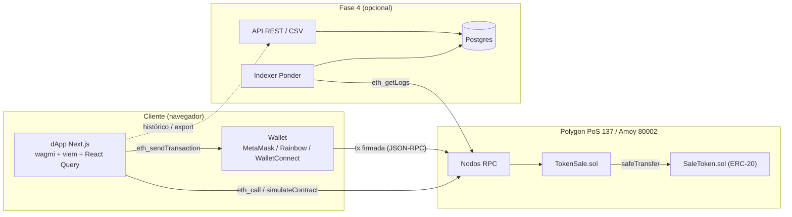
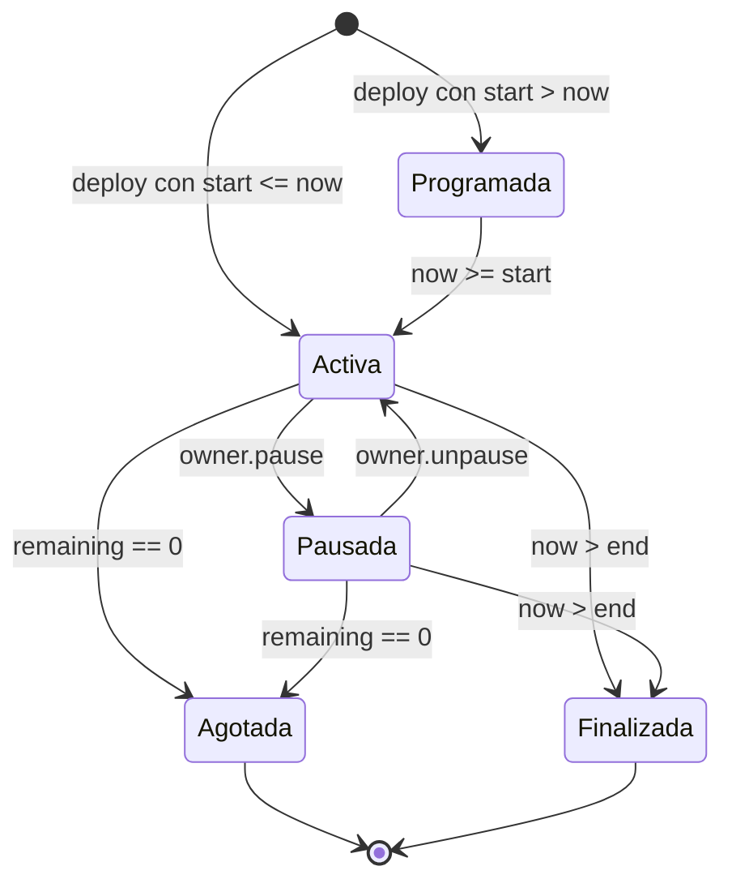

# DApp de venta de token sobre Polygon — Arquitectura

| | |
|---|---|
| **Versión** | 0.6 |
| **Fecha** | 2026-10-30 (rev. 2026-11-16) |
| **Estado** | Fase 1 completada y decisiones de la §15 cerradas. Repositorio organizado para alojamiento privado en GitHub. Fase 2 lista para Amoy. |
| **Red objetivo** | Polygon PoS (`chainId 137`) · pruebas en Polygon Amoy (`chainId 80002`) |
| **Alcance** | Prototipo de venta primaria de un token ERC-20 a precio fijo en POL + panel público de estado y distribución |
| **Cambios v0.2** | Docker-first (host solo con Docker), entornos DEV/PRE/PRO y convenciones de nombrado (archivos y código en inglés, documentación en español) |
| **Cambios v0.3** | §8.12: entorno local medido (Docker 29.9.1, Compose 5.6.0, `make` 3.81, 8 GiB para la VM, 44 GiB libres) y limpieza de residuos; nuevo [`ENVIRONMENT.md`](ENVIRONMENT.md); D15 actualizado con las versiones reales |
| **Cambios v0.4** | Fase 1 implementada: `compose*.yaml`, Dockerfiles con digest, `Makefile` compatible con 3.81, CI base y smoke tests; árbol de repositorio anotado con lo que existe y lo que queda por fase |
| **Cambios v0.5** | §15 cerrada: D1–D15 aceptadas con valores concretos (precio 0,01 POL/TK con tope 0,05; límites en tokens 1.000/100.000; Amoy como red de pruebas); §11 actualizado |
| **Cambios v0.6** | Organización del repositorio: `LICENSE`, `SECURITY.md`, `CONTRIBUTING.md`, `CODE_OF_CONDUCT.md`, `CHANGELOG.md`, plantillas de issue/PR, `CODEOWNERS`, Dependabot, `.editorconfig`/`.gitattributes` y verificación de enlaces en CI |

---

## 0. Resumen

Un contrato `TokenSale` custodia el inventario del token, lo vende a precio fijo en **POL** (token nativo de Polygon, antes MATIC) y mantiene **toda la contabilidad on-chain**: tokens vendidos, restantes, POL recaudado, número de compradores y detalle por wallet.

Una dApp **Next.js + wagmi/viem** lee ese estado directamente del contrato por RPC y firma las compras con la wallet del usuario. **Sin backend propio, sin custodia de claves y sin confiar en el cliente para el precio**: el contrato es la única fuente de verdad.

Todo el toolchain (Foundry, Node/pnpm, Anvil, Caddy, PostgreSQL) se ejecuta en **contenedores**: el host solo necesita Docker y Compose (§8). El mismo stack se reproduce en el VPS de PRE y de PRO.

```
Usuario ──firma──> Wallet ──tx──> TokenSale ──transfer──> Token ERC-20
   │                                  │
   └──lee estado──> dApp ──eth_call──> RPC Polygon
```

La decisión clave del diseño: **el contrato de venta es también el libro contable del dashboard**. Así la consulta de estado no depende de escanear eventos (frágil y caro en el navegador) y el prototipo puede funcionar sin infraestructura adicional. Un indexer de eventos se añade solo cuando haga falta histórico completo o “holders reales”.

---

## 1. Revisión crítica del alcance

El enunciado es correcto en la intención, pero tiene **seis puntos que hay que cerrar antes de escribir una línea de Solidity**. Si no se cierran, el prototipo se construye dos veces.

### 1.1 “Hash de wallet” no existe: es una dirección

- Una **dirección** es `0x` + 40 caracteres hex (`0x7A3…`), pública y estable. Es lo que se pide para consultar o para enviar tokens.
- Un **hash de transacción** (`0x` + 64 hex) identifica una operación, no una wallet.
- Una **clave privada / seed** es el secreto que firma. **La DApp no debe pedirla nunca, en ningún campo, ni siquiera “para verificar”.** Cualquier formulario que la pida es un phishing.

**Implicación:** el campo “pon tu wallet” es una **dirección pública** y solo sirve para *consultar* o para indicar el *destino* de los tokens. Para *pagar* hay que conectar la wallet y firmar; teclear una dirección no autoriza ningún cargo.

### 1.2 “Poner la wallet y el número de POL para comprar” mezcla dos modos

Hay que separar la UI en dos operaciones distintas:

| Modo | Entrada | Qué hace | Firma |
|---|---|---|---|
| **Consultar** | dirección `0x…` | lee `tokensPurchasedBy`, `weiPaidBy` | No |
| **Comprar** | wallet conectada + importe | `buy()` payable | Sí, la wallet conectada |

Si se permite teclear una dirección distinta de la conectada, el significado correcto es **“regalar tokens a esa dirección”** (`buyFor`): paga `msg.sender`, recibe el `receiver`. Es una función legítima, pero debe mostrarse claramente en el modal de confirmación para evitar regalos accidentales (o malware de portapapeles).

### 1.3 “Tokens distribuidos entre wallets” puede significar tres cosas

| Lectura | Dato necesario | Fuente |
|---|---|---|
| **A. Ventas de esta DApp** | compradores, importes, tokens | contabilidad del `TokenSale` (on-chain) |
| **B. Transferencias desde la wallet del propietario** (airdrops, equipo, tesorería) | historial `Transfer(from = owner)` | logs ERC-20 → **indexer** |
| **C. Holders actuales** (incluye compras secundarias) | saldos actuales de todas las wallets | logs `Transfer` + reconstrucción de saldos → **indexer** |

**ERC-20 no tiene enumeración de holders.** No se puede listar “todas las wallets con saldo” con una simple llamada. Para el prototipo propongo **A** (ventas de la DApp) y dejar **B/C** para la fase 4 con indexer. Hay que confirmar cuál es la necesidad real.

### 1.4 “Valor económico” necesita una unidad

El contrato liquida en **POL**. “Valorado en X €” es una capa de presentación:

- Opción simple: precio fijo en POL y el dashboard muestra POL + estimación EUR con un tipo de cambio.
- Opción pro: precio referenciado a EUR/USD con oráculo Chainlink (`POL/USD`) y actualización periódica. Añade dependencia externa y superficie de fallo.

Para el prototipo: **precio fijo en POL**, estimación EUR solo informativa (y etiquetada como tal).

### 1.5 “Wallet del contrato original” obliga a decidir dónde vive el inventario

Si los tokens están en la EOA del propietario, el contrato no puede venderlos salvo con `approve` + `transferFrom`, lo que añade pasos y confianza. Diseño propuesto: **el suministro se emite una sola vez al desplegar y el inventario se transfiere al `TokenSale`**. “Cuánto queda” = `token.balanceOf(sale)`, verificable por cualquiera.

### 1.6 Faltan en el alcance: reembolsos, límites, allowlist y legal

No están definidos y cambian el contrato: ¿devoluciones?, ¿mínimo/máximo por wallet?, ¿venta abierta o allowlist/KYC?, ¿vesting?, ¿qué pasa con lo no vendido?, ¿quién puede retirar la recaudación? Quedan cerrados en §15.

---

## 2. Decisiones de arquitectura

| ID | Decisión | Alternativa descartada | Motivo |
|---|---|---|---|
| **ADR-01** | Token **ERC-20 nuevo**, 18 decimales, suministro fijo, sin función `mint` | Token existente / ERC-721 | Control total y despliegue reproducible; el enunciado habla de tokens fraccionables |
| **ADR-02** | Contrato **`TokenSale` dedicado** que custodia el inventario | Vender desde la EOA con `transferFrom` | Precio y límites aplicados on-chain; estado consultable; sin firmas manuales por venta |
| **ADR-03** | Precio **fijo en POL** (wei) on-chain, mutable por el owner con tope y evento | Oráculo EUR/USD on-chain | Determinista y simple; el EUR es presentación |
| **ADR-04** | **Contabilidad on-chain + enumeración paginada** de compradores | Indexer desde el día 1 | Cero infraestructura; suficiente para el prototipo; migrable sin cambiar el contrato |
| **ADR-05** | **Sin backend propio** en fases 1–3 | API + base de datos | Menos superficie de ataque y coste; RPC + contrato bastan |
| **ADR-06** | Contratos **inmutables** (sin proxy) | UUPS / Transparent Proxy | Auditabilidad y simplicidad; si hace falta actualizar, se redespliega y se migra |
| **ADR-07** | **Foundry** (contratos) + **Next.js 15 / wagmi v2 / viem** (web) | Hardhat + ethers | Tests fuzz/invariant y ABI tipada; viem es ligero y tree-shakeable |
| **ADR-08** | Owner = **Safe multisig** en mainnet; EOA en Amoy | EOA también en mainnet | Reduce el riesgo de robo de clave y de “rug” accidental |
| **ADR-09** | **Amoy primero**, mainnet después | Solo mainnet | Probar con POL ficticio y repetir el flujo completo |
| **ADR-10** | **Sin upgradeabilidad y sin `delegatecall`** | Patrón proxy | Menos vectores; el contrato hace una sola cosa |
| **ADR-11** | **Docker-first**: todo el toolchain en contenedores; el host solo necesita Docker + Compose | Instalar Foundry/Node en cada máquina | Paridad DEV/PRE/PRO, onboarding reproducible y traslado directo al VPS |
| **ADR-12** | **Un proyecto Compose por entorno** (`dapp-pre`, `dapp-pro`) + edge compartido | Un único Compose con perfiles para todo | Aislamiento, despliegue y rollback independientes por entorno |
| **ADR-13** | **Archivos y código en inglés; documentación en español** | Mezclar idiomas | Consistencia con el ecosistema, `grep` predecible y onboarding más rápido |

### Stack concreto

- **Contratos:** Solidity `^0.8.24`, OpenZeppelin Contracts 5.x (`ERC20`, `Ownable2Step`, `Pausable`, `ReentrancyGuard`, `SafeERC20`, `Math.mulDiv`), Foundry (`forge`, `cast`, `anvil`) **en contenedor**.
- **Web:** Next.js 15 (App Router) + TypeScript, Tailwind + shadcn/ui, `wagmi` v2, `viem`, `@tanstack/react-query`, RainbowKit (o ConnectKit) para la conexión.
- **Indexer (fase 4, opcional):** Ponder (viem + Postgres) o subgraph de The Graph.
- **Toolchain:** Docker Engine + plugin Compose como **única dependencia de host** (medido: Engine 29.9.1, Compose 5.6.0, buildx 0.38.0); Foundry, Node 22, Caddy y PostgreSQL con versiones fijadas por digest.
- **Hosting:** VPS Linux con Docker + Caddy (TLS automático); RPC de Alchemy/Infura/QuickNode con fallback público.
- **Explorador:** Polygonscan (mainnet) y Amoy Polygonscan.

---

## 3. Vista de componentes



### Responsabilidades

| Componente | Responsabilidad | No debe hacer |
|---|---|---|
| `SaleToken` | ERC-20 estándar, suministro fijo | Mintear después del despliegue, tasas, rebasing |
| `TokenSale` | Custodiar inventario, cobrar, contabilizar, aplicar límites, retirar recaudación | Custodiar claves, depender de un oráculo, tener lógica de negocio ajena a la venta |
| dApp | Leer estado, validar en cliente, construir y simular la tx, mostrar resultado | Firmar, guardar claves, decidir el precio |
| Wallet | Autorizar y firmar | Nada más |
| Indexer (f4) | Histórico completo y consultas agregadas | Ser la fuente de verdad para el estado actual |

---

## 4. Modelo on-chain

### 4.1 `SaleToken.sol`

ERC-20 estándar con:

- `name`, `symbol`, `decimals = 18`.
- `constructor(uint256 initialSupply, address treasury)` → `_mint(treasury, initialSupply)`.
- **Sin `mint` posterior** (suministro inmutable), sin `burn`, sin fees, sin `permit` (no hace falta).
- Hereda de OpenZeppelin `ERC20`; no se toca la lógica de transferencias.

> El despliegue emite el 100 % del suministro al deployer; el script transfiere el inventario al `TokenSale` en la misma transacción de despliegue (§8.8). Lo que no se venda se queda en el `TokenSale` hasta el barrido posterior al cierre.

### 4.2 Estado del `TokenSale`

```solidity
// Identidad e inventario
IERC20  public immutable token;
uint8   public immutable tokenDecimals;   // 18, cacheado
uint256 public immutable totalSupply;     // leído en el constructor

// Economía
uint256 public pricePerTokenWei;          // wei de POL por 1 token entero (1e18 unidades)
uint256 public maxPricePerTokenWei;       // tope defensivo de setPrice
uint256 public minTokensPerPurchase;
uint256 public maxTokensPerWallet;        // 0 = sin límite
uint64  public startTime;
uint64  public endTime;

// Contabilidad
uint256 public totalTokensSold;
uint256 public totalRaisedWei;
uint256 public buyerCount;

mapping(address => uint256) public tokensPurchasedBy;
mapping(address => uint256) public weiPaidBy;
mapping(address => bool)    private _isBuyer;
address[] private _buyers;
```

**Por qué `weiPaidBy`:** si el precio cambia, el POL pagado por cada wallet **no** se puede derivar de los tokens comprados. Guardarlo por separado mantiene el dashboard exacto y permite conciliar `sum(weiPaidBy) == totalRaisedWei`.

### 4.3 Interfaz pública (ABI de referencia)

```solidity
interface ITokenSale {
    struct SaleState {
        address token;
        uint8   tokenDecimals;
        uint256 pricePerTokenWei;
        uint256 totalSupply;
        uint256 remainingTokens;   // balance del contrato de venta
        uint256 totalTokensSold;
        uint256 totalRaisedWei;
        uint256 buyerCount;
        uint64  startTime;
        uint64  endTime;
        bool    paused;
    }

    event TokensPurchased(
        address indexed buyer,
        address indexed receiver,
        uint256 tokenAmount,
        uint256 paidWei
    );
    event PriceUpdated(uint256 oldPriceWei, uint256 newPriceWei);
    event SaleWindowUpdated(uint64 startTime, uint64 endTime);
    event ProceedsWithdrawn(address indexed to, uint256 amountWei);
    event UnsoldSwept(address indexed to, uint256 tokenAmount);

    // --- Usuario ---
    function buy(uint256 tokenAmount) external payable;
    function buyFor(address receiver, uint256 tokenAmount) external payable;

    // --- Lectura ---
    function quote(uint256 tokenAmount) external view returns (uint256 costWei);
    function saleState() external view returns (SaleState memory);
    function remainingTokens() external view returns (uint256);
    function tokensPurchasedBy(address buyer) external view returns (uint256);
    function weiPaidBy(address buyer) external view returns (uint256);
    function getBuyers(uint256 offset, uint256 limit)
        external view
        returns (address[] memory buyers, uint256[] memory tokenAmounts, uint256[] memory paidWei);

    // --- Owner ---
    function setPrice(uint256 newPriceWei) external;
    function setSaleWindow(uint64 startTime, uint64 endTime) external;
    function pause() external;
    function unpause() external;
    function withdrawProceeds(address payable to) external;
    function sweepUnsold(address to) external;
    function sweepForeignToken(IERC20 otherToken, address to) external;
}
```

### 4.4 Reglas de `buy` (orden exacto de validación)

1. `whenNotPaused`.
2. `block.timestamp >= startTime` y `block.timestamp <= endTime`.
3. `tokenAmount > 0` y `tokenAmount >= minTokensPerPurchase`.
4. `tokenAmount <= remainingTokens()` (si no: `SoldOut`).
5. `receiver != address(0)` y `receiver != address(this)` (si no: `InvalidReceiver`).
6. `tokensPurchasedBy[receiver] + tokenAmount <= maxTokensPerWallet` (si el límite es > 0).
7. `cost = quote(tokenAmount)` y `msg.value == cost` (sin reembolsos parciales; el exceso revierte).
8. **Checks-Effects-Interactions:** actualizar `tokensPurchasedBy`, `weiPaidBy`, `totalTokensSold`, `totalRaisedWei`, `buyerCount`, `_buyers`.
9. `token.safeTransfer(receiver, tokenAmount)`.
10. `emit TokensPurchased(msg.sender, receiver, tokenAmount, cost)`.

`quote(amount) = Math.mulDiv(amount, pricePerTokenWei, 10 ** tokenDecimals)`.

> Redondeo: `mulDiv` trunca a favor del comprador por menos de 1 wei. Aceptable y documentado; los tests lo cubren.

### 4.5 Errores personalizados

```solidity
error SalePaused();
error SaleNotStarted();
error SaleEnded();
error ZeroAmount();
error BelowMinimum(uint256 minimum);
error SoldOut();
error AboveWalletCap(uint256 cap);
error IncorrectPayment(uint256 expectedWei, uint256 receivedWei);
error InvalidReceiver();
error InvalidPrice();
error InvalidWindow();
error SaleNotEnded();
error InvalidToken();
error TransferFailed();
```

Los mensajes de la UI se mapean desde estos selectores, no desde textos de RPC.

### 4.6 Invariantes (verificables con tests)

1. `token.balanceOf(sale) + totalTokensSold == totalSupply` (sin transferencias externas al contrato).
2. `sum(weiPaidBy[buyer]) == totalRaisedWei`.
3. `sum(tokensPurchasedBy[buyer]) == totalTokensSold`.
4. `buyerCount == _buyers.length` y cada dirección aparece una sola vez.
5. Ninguna compra fuera de `[startTime, endTime]`, en pausa, por encima del cap o con `msg.value` distinto de `quote`.
6. `totalTokensSold <= totalSupply` **siempre**.

### 4.7 Estados de la venta



El estado se deriva en lectura (no se almacena) para evitar escrituras y condiciones de carrera:

```
paused                        -> PAUSADA
now < start                   -> PROGRAMADA
remaining == 0                -> AGOTADA
now > end                     -> FINALIZADA
resto                         -> ACTIVA
```

### 4.8 Funciones de owner y superficies de confianza

| Función | Quién | Guardas | Efecto |
|---|---|---|---|
| `setPrice` | owner | `0 < newPrice <= maxPrice`, evento | Cambia el precio de las compras futuras |
| `setSaleWindow` | owner | `start < end`, evento | Ajusta la ventana |
| `pause` / `unpause` | owner | `Pausable` | Bloquea compras (no retiradas) |
| `withdrawProceeds(to)` | owner | `to != 0`, `nonReentrant`, evento | Envía todo el POL del contrato |
| `sweepUnsold(to)` | owner | `now > endTime`, `to != 0`, evento | Envía los tokens no vendidos |
| `sweepForeignToken` | owner | `otherToken != token` | Recupera ERC-20 enviados por error |

> **Riesgo inherente:** el owner puede retirar la recaudación y cambiar el precio. No es un bug, es un modelo de confianza. Se mitiga con Safe multisig, eventos y, si el cliente lo exige, con un `beneficiary` inmutable y precio congelado (variante del contrato, no del prototipo).

---

## 5. Estrategia de datos y consultas

### 5.1 Fase 1–3: lectura directa por RPC

| Dato | Llamada | Coste |
|---|---|---|
| Snapshot del dashboard | `saleState()` | 1 `eth_call` |
| Página de compradores | `getBuyers(offset, 50)` | 1 `eth_call` |
| Detalle de una wallet | `tokensPurchasedBy(addr)` + `weiPaidBy(addr)` | 1–2 `eth_call` (o `multicall`) |
| Balances y metadatos | `balanceOf`, `symbol`, `decimals` | 1 `multicall` |

`getBuyers` limita `limit <= 100` para evitar respuestas gigantes y abuso de gas de lectura. La UI pagina de 25 en 25.

**No se usa `eth_getLogs` desde el navegador:** los RPC públicos limitan el rango de bloques y el resultado es frágil. Si se necesita histórico, se hace en un indexer.

### 5.2 Cuándo añadir un indexer

Señales para pasar a Ponder/The Graph:

- Más de ~2.000 compradores (la paginación on-chain se vuelve incómoda).
- Necesidad de histórico por fecha, gráficas, export CSV o “holders reales” (lecturas B/C de §1.3).
- Varias fuentes de datos (varios contratos o cadenas).
- Necesidad de consultas por rango temporal.

El indexer **no sustituye** la lectura on-chain para el estado actual: `saleState()` sigue mandando. El indexer añade histórico y agregados.

### 5.3 Modelo del indexer (fase 4)

```
Tabla sales:  id, tx_hash, block_number, block_time, buyer, receiver,
              token_amount, paid_wei, price_wei
Tabla buyers: address, tokens_total, paid_total, first_seen, last_seen
```

Endpoints previstos:

```
GET /api/sale                 -> SaleState + métricas derivadas
GET /api/buyers?limit&offset  -> lista paginada
GET /api/buyers/:address      -> detalle
GET /api/export.csv           -> export para conciliación
```

### 5.4 Caché en la dApp

- TanStack Query con `staleTime: 10_000` y `refetchInterval: 15_000` (Polygon produce bloques ~2 s; no hace falta más).
- Invalidar `['sale']`, `['buyers']` y `['buyer', addr]` al recibir el recibo de una compra.
- No cachear en `localStorage` datos que puedan quedar obsoletos sin marca de tiempo.

---

## 6. Frontend

### 6.1 Rutas

| Ruta | Contenido |
|---|---|
| `/` | Dashboard + formulario de compra |
| `/wallet/[address]` (o `?addr=`) | Consulta read-only de una wallet |
| `/admin` (fase 4) | Pausa, precio, retirada, barrido; visible solo si `owner() == cuenta` |
| `/legal` | Términos, privacidad y aviso de riesgo |

### 6.2 Dashboard: métricas

- Nombre, símbolo, suministro total y dirección del token (con enlace a Polygonscan).
- Precio actual en POL (y estimación EUR opcional, etiquetada).
- Tokens vendidos / restantes / **% vendido** (barra de progreso).
- POL recaudado (y estimación EUR).
- Nº de compradores.
- **FDV** = precio × suministro; **valor vendido** = precio × vendidos (ambos con la salvedad de que el precio puede haber cambiado).
- Estado de la ventana (programada / activa / pausada / agotada / finalizada) y cuenta atrás.
- Dirección del contrato de venta y del token, verificadas y enlazadas al explorador.
- Tabla de últimas compras (paginada) y buscador por wallet.

### 6.3 Flujo de compra (UI)

1. **Conectar wallet** (RainbowKit). Si la red no es Polygon/Amoy, mostrar botón “Cambiar a Polygon” (`wallet_switchEthereumChain`).
2. **Leer estado** con `saleState()`. Si no está activa, deshabilitar el formulario con el motivo.
3. **Introducir cantidad** (en POL o en tokens, con toggle) y, opcionalmente, **dirección destino** distinta de la conectada (`buyFor`).
4. **Calcular** `quote()` en vivo; mostrar precio unitario, total y comisión de gas estimada.
5. **Validar**: dirección con checksum (`getAddress`/`isAddress`), saldo suficiente para importe + gas, límites de la ventana.
6. **Simular** con `simulateContract` antes de firmar. Si revierte, mostrar el error mapeado y no abrir la wallet.
7. **Confirmar** en un modal con: red, contrato, destino, cantidad, total, gas estimado y aviso si `destino != wallet conectada`.
8. **Firmar y enviar**; mostrar el hash inmediatamente con enlace al explorador.
9. **Esperar recibo** (`waitForTransactionReceipt`, timeout ~90 s). Si `status === 'reverted'`, informar y refrescar.
10. **Refrescar** estado y tabla; mostrar resumen (“has recibido X TK por Y POL”).

### 6.4 Consulta por wallet

- Acepta `0x…` (40 hex). Valida checksum y muestra la dirección completa en formato corto + copiar.
- Devuelve: tokens comprados, POL pagados, % del total vendido, fecha de la primera compra (si hay indexer) y enlace a la tx.
- Si la dirección no ha comprado: estado vacío explícito, no un error.
- **Nunca** se envía la dirección a analítica de terceros sin consentimiento (dato personal según GDPR).

### 6.5 Configuración

```env
NEXT_PUBLIC_CHAIN_ID=80002
NEXT_PUBLIC_SALE_ADDRESS=0x...
NEXT_PUBLIC_TOKEN_ADDRESS=0x...
NEXT_PUBLIC_RPC_URL=https://...
NEXT_PUBLIC_WC_PROJECT_ID=...
```

- Direcciones y ABI en `web/lib/deployments.ts`, generadas desde `deployments/<chainId>.json`; **nunca** se aceptan direcciones por query string para operar.
- La clave del RPC, si es de proveedor, se restringe por dominio en el panel del proveedor; nunca se asume secreta.
- En DEV hay dos URLs distintas para el mismo Anvil: el navegador usa `http://localhost:8545` (puerto publicado) y los contenedores usan `http://anvil:8545` (DNS interno). No mezclarlas en una sola variable: `NEXT_PUBLIC_RPC_URL` es para el navegador.

### 6.6 Manejo de errores

| Condición | Mensaje UX |
|---|---|
| Usuario rechaza la firma | “Has cancelado la firma” (sin reintentar automáticamente) |
| Red incorrecta | “Estás en otra red” + botón de cambio |
| Saldo insuficiente | “No tienes POL suficiente para el importe + gas” |
| `SoldOut` | “No quedan tokens disponibles” |
| `AboveWalletCap` | “Superas el máximo por wallet (X TK)” |
| `IncorrectPayment` | “El precio ha cambiado; recalculando…” + re-quote |
| `SaleNotStarted` / `SaleEnded` | “La venta no está activa” |
| `SalePaused` | “La venta está pausada temporalmente” |
| Error de RPC / timeout | “No se pudo contactar con la red; reintenta” + reintento manual |

Los errores se decodifican con el ABI (`decodeErrorResult`) para no mostrar mensajes crudos del nodo.

---

## 7. Seguridad

### 7.1 Modelo de amenazas

| # | Amenaza | Vector | Mitigación | Residual |
|---|---|---|---|---|
| 1 | Robo de clave/seed | Phishing, malware, web falsa | Nunca pedir seed; hardware wallet; educación; dominio oficial | Usuario comprometido |
| 2 | Sustitución de contrato/ABI | DNS o JS comprometido | Direcciones fijas en config versionada; verificación en Polygonscan; CSP y dependencias fijadas | Hosting/CDN |
| 3 | Cambio de dirección (portapapeles) | Malware | Mostrar dirección completa con checksum en el modal; comparar con la pegada | Malware local |
| 4 | Reentrancy | `to.call` en retiradas o token malicioso | CEI + `nonReentrant` + token propio | Bajo |
| 5 | Precio manipulado en cliente | Usuario edita JS | El contrato valida `msg.value == quote` | Nulo |
| 6 | Front-running del cambio de precio | Owner sube precio | Evento + tope + transparencia; timelock opcional | Medio |
| 7 | “Rug” del owner | Retirada o cambio de precio | Safe multisig + eventos + documentación; variante con `beneficiary` inmutable | Medio |
| 8 | DoS por enumeración | Muchos compradores | Paginación + límite de `limit`; indexer en fase 4 | Bajo |
| 9 | RPC deshonesto/obsoleto | Proveedor o red | Varios RPC en fallback; confirmar con recibo; leer logs del recibo | Bajo |
| 10 | Clon de la dApp | Dominio parecido | Dominio oficial, verificación, comunicación | Externo |
| 11 | POL/tokens enviados por error | Usuario | Sin `receive()` genérico; `sweepForeignToken`; documentación | Tokens bloqueados hasta barrido |
| 12 | Precisión/redondeo | Aritmética | `mulDiv`, 18 decimales, tests de borde | Nulo |
| 13 | Congelación por pausa | Owner | Pausa solo bloquea compras, no retiradas ni barrido | Confianza |

### 7.2 Controles en el contrato (checklist)

- [ ] OpenZeppelin 5.x: `Ownable2Step`, `Pausable`, `ReentrancyGuard`, `SafeERC20`, `Math.mulDiv`.
- [ ] CEI en `buy` / `buyFor`; `nonReentrant` en `buy`, `buyFor`, `withdrawProceeds`.
- [ ] `msg.value` exacto (sin reembolsos parciales) y validación de todos los límites.
- [ ] `buyerCount` y `_buyers` sin duplicados (`_isBuyer`).
- [ ] `withdrawProceeds` y `sweepUnsold` solo owner, con evento y destino no nulo.
- [ ] `sweepUnsold` solo después de `endTime`.
- [ ] Sin `receive()`/`fallback()` genéricos; solo `buy` es payable.
- [ ] Sin `delegatecall`, sin `selfdestruct`, sin `tx.origin`.
- [ ] Token sin fees de transferencia, sin rebasing y sin `mint` posterior.
- [ ] `maxPricePerTokenWei` como cota dura de `setPrice`.
- [ ] Tests unitarios + fuzz + invariantes + fork de Amoy.
- [ ] Verificación en Polygonscan + Sourcify; ownership a Safe antes de mainnet.

### 7.3 Controles en la dApp (checklist)

- [ ] No se pide seed ni clave privada en ningún flujo, ni siquiera “para verificar”.
- [ ] `simulateContract` antes de cada escritura.
- [ ] Modal de confirmación con red + contrato + destino + importe.
- [ ] Validación de checksum y bloqueo de direcciones inválidas o `0x0`.
- [ ] `bigint` en todo el camino; nunca `number` para wei.
- [ ] Manejo de `status: 'reverted'` del recibo, no solo del envío.
- [ ] Bloqueo de doble envío y de envíos con la ventana cerrada.
- [ ] CSP, `SRI` si hay scripts externos, dependencias con lockfile.
- [ ] Sin analítica con direcciones ni datos personales sin consentimiento.
- [ ] Enlaces al explorador correctos por red (Amoy vs mainnet).

### 7.4 Antes de mainnet

1. Congelar ABI y direcciones; etiquetar el release.
2. Repetir el flujo completo en Amoy con varias wallets y casos límite.
3. Revisión externa (auditoría o, como mínimo, peer review con checklist).
4. Ownership a Safe multisig; claves en hardware wallet.
5. Verificar contratos y publicar direcciones en un canal oficial.
6. Monitorizar: alertas de balance, de pausa y de eventos `TokensPurchased`.
7. Plan de incidentes: pausar, comunicar, y decidir sobre reembolsos por escrito.

---

## 8. Contenedores y entornos (Docker-first)

> **Regla arquitectónica:** ninguna herramienta de desarrollo se instala en el host. El host solo necesita **Docker Engine + plugin Compose** (medido en el host de referencia: Engine 29.9.1, Compose 5.6.0, buildx 0.38.0). Foundry, Node/pnpm, Anvil, Caddy, PostgreSQL y Ponder se ejecutan en contenedores con versiones fijadas. El mismo stack se reproduce en el VPS sin reinstalar nada.

Este cambio es estructural, no cosmético: la paridad entre desarrollo, PRE y PRO deja de depender de la memoria de cada persona y pasa a ser una propiedad del repositorio.

### 8.1 Principios

1. **Una sola dependencia de host:** Docker + plugin Compose. `make` es opcional (solo envuelve comandos de Compose) y en macOS es **3.81**, así que el `Makefile` no puede usar características de GNU Make 4 (§8.12).
2. **Versiones fijadas por digest**, nunca `latest` en PRE/PRO.
3. **Mismo código, distinta configuración:** las diferencias entre entornos viven en `.env.*` y en los build args, nunca en ramas de código.
4. **Imágenes multi-stage e inmutables:** sin toolchains de build en la imagen final; non-root en runtime.
5. **Secretos fuera de la imagen y del repositorio:** `.env.*` en el host/VPS con `chmod 600`; Docker secrets para PRO.
6. **Un proyecto Compose por entorno en el VPS** (`dapp-pre`, `dapp-pro`) y un **edge** compartido que hace de reverse proxy.
7. **Nada de puertos publicados** salvo 80/443 en el edge; web y base de datos solo en redes internas.
8. **El VPS de la web no custodia claves de despliegue ni claves del owner.**

### 8.2 Matriz de entornos

| | **DEV** | **PRE** | **PRO** |
|---|---|---|---|
| Host | portátil | VPS | VPS |
| Compose | `compose.yaml` + `compose.dev.yaml` | `compose.yaml` + `compose.pre.yaml` (+ edge) | `compose.yaml` + `compose.pro.yaml` (+ edge) |
| Cadena | Anvil `31337` (fork Amoy opcional) | Amoy `80002` | Polygon PoS `137` |
| Web | `next dev` con hot reload | imagen `web:pre` tras Caddy | imagen `web:pro` tras Caddy |
| Contratos | `forge test` contra Anvil | desplegados y verificados en Amoy | desplegados y verificados en mainnet |
| Owner | cuenta Anvil | EOA de prueba | Safe multisig |
| URL | `http://localhost:3000` | `https://pre.<dominio>` | `https://app.<dominio>` |
| Acceso | abierto | Basic Auth o allowlist IP | público |
| Datos | efímeros | volumen desechable | backup diario |
| Claves | `.env.dev` | `.env.pre` (`600`) | `.env.pro` (`600`) + secrets |

PRE y PRO comparten host mientras el proyecto sea un prototipo. Para producción real se recomienda **VPS separados**: un fallo o un `docker compose down` en PRE no debe poder tumbar PRO.

### 8.3 Inventario de contenedores

| Servicio | Imagen / build | DEV | PRE | PRO | Notas |
|---|---|---|---|---|---|
| `contracts` | `contracts/Dockerfile` (Foundry fijado) | ✔ | one-shot | one-shot | tests, `cast` y scripts de despliegue; perfil `tools` |
| `anvil` | misma imagen Foundry | ✔ | — | — | nodo local; `--fork-url` opcional |
| `web` | `web/Dockerfile` | ✔ (`target: dev`) | ✔ | ✔ | Next.js `standalone` |
| `edge` | `caddy:2-alpine` fijado | — | ✔ | ✔ | TLS automático y routing por dominio |
| `db` | `postgres:16-alpine` fijado | opcional | fase 4 | fase 4 | solo red interna |
| `indexer` | `docker/indexer/Dockerfile` (Ponder) | opcional | fase 4 | fase 4 | solo fase 4 |

`contracts` y `anvil` usan el perfil de Compose `tools` para no arrancar por defecto en el VPS.

### 8.4 Compose por entorno

La composición es acumulativa: una **base** común y un **override** por entorno. La imagen se inyecta por variable (`WEB_IMAGE`) y solo DEV añade `build:`; así el VPS siempre hace `pull` y nunca compila.

```yaml
# compose.yaml — base común
name: dapp-tk

services:
  web:
    image: ${WEB_IMAGE:-dapp-tk-web:local}
    expose:
      - "3000"
    networks:
      - internal
    restart: unless-stopped
    healthcheck:
      test: ["CMD", "wget", "-qO-", "http://127.0.0.1:3000/api/health"]
      interval: 30s
      timeout: 5s
      retries: 3

networks:
  internal:
    driver: bridge
```

```yaml
# compose.dev.yaml — desarrollo local
services:
  web:
    build:
      context: ./web
      target: dev
    env_file:
      - .env.dev
    command: pnpm dev
    ports:
      - "3000:3000"
    volumes:
      - ./web:/app
      - web_node_modules:/app/node_modules
    environment:
      WATCHPACK_POLLING: "true"

  anvil:
    image: ghcr.io/foundry-rs/foundry:${FOUNDRY_VERSION:?set FOUNDRY_VERSION}
    command: anvil --host 0.0.0.0 --chain-id 31337
    ports:
      - "8545:8545"

volumes:
  web_node_modules:
```

```yaml
# compose.tools.yaml — trabajos one-shot (tests y despliegue)
services:
  contracts:
    build:
      context: ./contracts
      args:
        FOUNDRY_VERSION: ${FOUNDRY_VERSION:?set FOUNDRY_VERSION}
    working_dir: /app
    env_file:
      - ${ENV_FILE:-.env.dev}
    volumes:
      - ./contracts:/app
      - ./deployments:/app/deployments
```

```yaml
# compose.pre.yaml — VPS, preproducción
services:
  web:
    image: ${WEB_IMAGE:-ghcr.io/<org>/dapp-tk-web:pre}
    env_file:
      - .env.pre
    networks:
      internal:
      edge:
        aliases:
          - web-pre

networks:
  edge:
    external: true
```

```yaml
# compose.pro.yaml — VPS, producción
services:
  web:
    image: ${WEB_IMAGE:-ghcr.io/<org>/dapp-tk-web:pro}
    env_file:
      - .env.pro
    networks:
      internal:
      edge:
        aliases:
          - web-pro
    read_only: true
    tmpfs:
      - /tmp
      - /app/.next/cache
    security_opt:
      - no-new-privileges:true
    deploy:
      resources:
        limits:
          cpus: "1.0"
          memory: 512M

networks:
  edge:
    external: true
```

```yaml
# compose.edge.yaml — un único reverse proxy por VPS
name: dapp-edge
services:
  caddy:
    image: caddy:2.8-alpine
    ports:
      - "80:80"
      - "443:443"
    volumes:
      - ./docker/Caddyfile:/etc/caddy/Caddyfile:ro
      - caddy_data:/data
      - caddy_config:/config
    networks:
      - edge
    restart: unless-stopped

networks:
  edge:
    name: edge
    external: true

volumes:
  caddy_data:
  caddy_config:
```

`docker/Caddyfile` (TLS automático; PRE protegido con Basic Auth):

```caddyfile
{
	email ops@example.com
}

pre.example.com {
	basic_auth {
		admin $2a$14$REPLACE_WITH_BCRYPT_HASH
	}
	reverse_proxy web-pre:3000
	encode zstd gzip
	header {
		Strict-Transport-Security "max-age=31536000; includeSubDomains"
		X-Content-Type-Options "nosniff"
		Referrer-Policy "strict-origin-when-cross-origin"
		-Server
	}
}

app.example.com {
	reverse_proxy web-pro:3000
	encode zstd gzip
	header {
		Strict-Transport-Security "max-age=31536000; includeSubDomains"
		X-Content-Type-Options "nosniff"
		Referrer-Policy "strict-origin-when-cross-origin"
		-Server
	}
}
```

### 8.5 Imágenes

**Web** (`web/Dockerfile`, contexto `./web`): multi-stage `deps → dev → builder → runner`, Node 22 Alpine, pnpm por `corepack`, salida `standalone`, usuario non-root y healthcheck.

```dockerfile
# web/Dockerfile
# syntax=docker/dockerfile:1.7
FROM node:22-alpine AS base
RUN corepack enable
WORKDIR /app
ENV NEXT_TELEMETRY_DISABLED=1

FROM base AS deps
COPY package.json pnpm-lock.yaml ./
RUN pnpm install --frozen-lockfile

FROM deps AS dev
COPY . .
CMD ["pnpm", "dev"]

FROM base AS builder
ARG NEXT_PUBLIC_CHAIN_ID
ARG NEXT_PUBLIC_SALE_ADDRESS
ARG NEXT_PUBLIC_TOKEN_ADDRESS
ARG NEXT_PUBLIC_RPC_URL
COPY --from=deps /app/node_modules ./node_modules
COPY . .
RUN pnpm build

FROM base AS runner
ENV NODE_ENV=production
RUN addgroup -S app && adduser -S app -G app
COPY --from=builder --chown=app:app /app/.next/standalone ./
COPY --from=builder --chown=app:app /app/.next/static ./.next/static
COPY --from=builder --chown=app:app /app/public ./public
USER app
EXPOSE 3000
CMD ["node", "server.js"]
```

> `next.config.ts` debe declarar `output: 'standalone'`. Las variables `NEXT_PUBLIC_*` **se incrustan en build**: PRE y PRO son dos builds del mismo commit (matriz de CI), no la misma imagen con distinto `.env`. Es el precio de no añadir un endpoint de configuración en runtime; para el prototipo es la opción más simple y explícita.

**Contratos** (`contracts/Dockerfile`): imagen oficial de Foundry fijada por versión y digest, usuario no-root y caché de `solc` en volumen.

```dockerfile
# contracts/Dockerfile
ARG FOUNDRY_VERSION
FROM ghcr.io/foundry-rs/foundry:${FOUNDRY_VERSION}
WORKDIR /app
RUN useradd -m -u 1000 app && chown -R app:app /app
USER app
ENV SVM_HOME=/home/app/.svm
```

> `FOUNDRY_VERSION` admite la forma `v1.3.5@sha256:…`, que es la recomendada para PRE/PRO. Verificar con `docker buildx imagetools inspect` que la versión elegida publica `linux/amd64` **y** `linux/arm64` (portátil Apple + VPS x86). Si falta ARM, construir la imagen propia con `buildx` o usar emulación solo en DEV.

### 8.6 Redes, volúmenes y permisos

- **Redes:** `internal` por proyecto (bridge) + `edge` externa compartida solo por `caddy` y los `web`. La base de datos, si existe, nunca se conecta a `edge`.
- **Puertos:** `web` solo `expose: 3000`; `db` sin `ports`; únicos puertos publicados `80/443` en el edge.
- **Volúmenes:** `web_node_modules` (evita que el bind mount de DEV machaque las dependencias instaladas en la imagen), `caddy_data`/`caddy_config`, `pg_data` y caché de Foundry (`/home/app/.svm`).
- **Bind mounts solo en DEV.** En PRE/PRO se usa la imagen inmutable; los datos van a volúmenes.
- **UID/GID:** en el VPS, `user: "${UID:-1000}:${GID:-1000}"` y volúmenes con propietario correcto. En macOS Docker Desktop la emulación de permisos es laxa; no sirve como prueba de permisos de Linux.
- **`no-new-privileges`, `read_only` donde se pueda y límites de CPU/memoria** en PRO.

### 8.7 Secretos y claves

| Secreto | Dónde vive | Dónde **no** vive |
|---|---|---|
| Clave del deployer | CI secret + `--keystore` montado en el contenedor one-shot | repositorio, imagen, VPS web |
| Clave del owner | Safe multisig (firmantes con hardware wallet) | infraestructura |
| RPC API key | `.env.pre`/`.env.pro` y restricción por dominio | `NEXT_PUBLIC_*` en claro sin restricción |
| Password de Postgres | Docker secret | `compose.yaml` |
| Hash de Basic Auth de PRE | `Caddyfile` (solo hash bcrypt) | texto plano |

Reglas:

- `.env.example` versionado **solo con nombres**; `.env.*` reales en `.gitignore` y `chmod 600`.
- `NEXT_PUBLIC_*` es **público por definición** (acaba en el bundle). Nunca metas una clave secreta ahí. Si el proveedor de RPC no permite restringir por dominio, poner un proxy `/api/rpc` en el servidor Next y no exponer la clave.
- En PRO, `docker secret` para todo lo sensible; en PRE, `.env` con permisos restringidos es suficiente.
- Rotación documentada: RPC key, deployer key (nueva cuenta), password de Postgres.

### 8.8 Despliegue de contratos (contenedor one-shot)

El despliegue **no se ejecuta en el VPS de la web**. Se ejecuta desde el portátil del responsable o desde CI, con el stack `compose.tools.yaml` y el `.env` del entorno:

```bash
# tests
ENV_FILE=.env.dev docker compose -f compose.tools.yaml run --rm contracts forge test -vvv

# despliegue en Amoy (PRE)
ENV_FILE=.env.pre docker compose -f compose.tools.yaml run --rm contracts \
  forge script script/Deploy.s.sol --broadcast --verify

# despliegue en Polygon mainnet (PRO) — requiere aprobación manual
ENV_FILE=.env.pro docker compose -f compose.tools.yaml run --rm contracts \
  forge script script/Deploy.s.sol --broadcast --verify
```

`ETH_RPC_URL` y `ETHERSCAN_API_KEY` se leen del `env_file` dentro del contenedor; no se expanden en el host.

Secuencia (la misma de siempre, ahora containerizada):

1. `SaleToken(initialSupply, deployer)` → suministro fijo emitido al deployer.
2. `TokenSale(token, price, start, end, minTokens, maxPerWallet, owner)`.
3. `token.transfer(sale, inventory)` → el contrato de venta recibe el inventario.
4. Verificar ambos contratos en Polygonscan.
5. Escribir `deployments/<chainId>.json` (volumen montado) y commitearlo/etiquetarlo.
6. (Mainnet) Transferir la ownership a la Safe **y verificar** que `owner()` es la Safe.

### 8.9 Despliegue de la web y CI/CD

Flujo: **CI construye y publica en GHCR; el VPS solo hace `pull` y `up`.** Nunca se compila en PRO.

| Pipeline | Disparo | Pasos | Puerta |
|---|---|---|---|
| `ci` | PR / push | `forge fmt --check`, `forge test`, lint, typecheck, `next build`, escaneo de imagen | obligatoria |
| `images` | tag `v*` | buildx multi-arch y push `web:sha-<commit>`, `:pre`, `:pro` (dos builds por `NEXT_PUBLIC_*`) | — |
| `deploy-pre` | tag o merge | `pull` + `up -d` en VPS PRE, smoke test HTTPS | automática |
| `deploy-pro` | release manual | `pull` + `up -d` en VPS PRO | aprobación en GitHub Environments |
| `deploy-contracts-pre` | manual | `forge script` en Amoy, publicar `deployments/80002.json` | aprobación |
| `deploy-contracts-pro` | manual | `forge script` en mainnet + ownership a Safe | doble aprobación |

En el VPS:

```bash
docker network create edge                                     # una vez
docker compose -f compose.edge.yaml -p dapp-edge up -d          # una vez
WEB_IMAGE=ghcr.io/<org>/dapp-tk-web:sha-<commit> \
  docker compose -f compose.yaml -f compose.pre.yaml -p dapp-pre up -d
WEB_IMAGE=ghcr.io/<org>/dapp-tk-web:sha-<commit> \
  docker compose -f compose.yaml -f compose.pro.yaml -p dapp-pro up -d
```

- **Rollback:** volver a poner el tag anterior en `WEB_IMAGE` y `up -d`. Sin rebuild.
- **Zero-downtime:** aceptable un corte de segundos en el prototipo; si se exige, blue/green con dos servicios y conmutación en Caddy.
- **Healthcheck:** `/api/health` responde 200 y el despliegue se considera fallido si no queda `healthy` en 60 s.

### 8.10 VPS: baseline, backups y monitorización

**Sistema**

- Ubuntu 24.04 LTS; Docker Engine 27+ y plugin Compose (repositorio oficial). El host de desarrollo validó el stack con Engine 29.9.1 y Compose 5.6.0 (§8.12); en PRE/PRO se fija la misma pareja mayor.
- Usuario `deploy` no-root en el grupo `docker`; SSH solo con clave; `PermitRootLogin no`.
- UFW: 22, 80, 443. `fail2ban` y `unattended-upgrades` activos.
- Nunca montar `/var/run/docker.sock` dentro de un contenedor.

**Capacidad**

- Web + edge: 2 vCPU / 2 GB / 40 GB es suficiente.
- Con indexer + Postgres: 2 vCPU / 4 GB y backups diarios.

**Backups**

- `deployments/` versionado en git (fuente de verdad de direcciones).
- `pg_dump` diario a almacenamiento externo (fase 4).
- Volumen `caddy_data` (certificados) incluido en backup.
- `.env.pro` en gestor de contraseñas, no solo en el VPS.

**Monitorización**

- Healthchecks de Compose + monitor externo de uptime (HTTPS y certificado).
- Logs con `json-file` limitado (`max-size: 10m`, `max-file: 3`); Loki opcional.
- Alertas on-chain: balance del `TokenSale`, evento `TokensPurchased`, cambios de owner/precio (Tenderly o similar).
- Actualizaciones por PR (Renovate/Dependabot), con ventana y rollback; **sin Watchtower en PRO**.

### 8.11 Excepciones conscientes

- **Hardware wallet:** un Ledger no se pasa al contenedor. La firma con hardware wallet se hace con `cast` en un host endurecido o, preferiblemente, con `--keystore` en CI y aprobación manual. Es la única excepción documentada al “todo en Docker”.
- **Rendimiento en macOS:** bind mounts y Anvil en contenedor son algo más lentos que en Linux; se mitiga con volúmenes nombrados y `WATCHPACK_POLLING`. No afecta a PRE/PRO.
- **Build args públicos:** `NEXT_PUBLIC_*` obliga a dos builds (PRE y PRO) por release; se acepta para no añadir configuración en runtime.

### 8.12 Entorno local verificado (2026-10-30)

Medición del host de desarrollo antes de arrancar la Fase 1. El detalle completo, las restricciones derivadas y el checklist de verificación están en [`ENVIRONMENT.md`](ENVIRONMENT.md).

| Elemento | Valor medido | Implicación |
|---|---|---|
| Máquina | MacBook Pro M1, macOS 26.7.1, 8 vCPU, 16 GiB RAM | ARM64 nativo; `linux/amd64` solo por Rosetta |
| Docker | Engine 29.9.1 · Desktop 4.96.0 · buildx 0.38.0 · BuildKit 0.34.0 | Compatible con `dockerfile:1.7` y builds multi-arch |
| Compose | **v5.6.0** (plugin) | La v0.2 citaba “v2”; el fichero sigue siendo `compose.yaml` y la sintaxis no cambia |
| VM de Docker | 8 vCPU · 8 GiB · overlayfs | Techo real de memoria para builds concurrentes |
| Toolchain de host | `git` 2.50.1, `make` **3.81**, `jq`, `curl`; **sin** node/pnpm/forge/caddy/psql | Cumple ADR-11; `Makefile` compatible con 3.81 |
| Disco | 228 GiB, **44 GiB libres** (78 % usado) | Recurso más ajustado; no acumular tags ni caché |
| Red | GHCR y Docker Hub accesibles; SSH a GitHub OK como `josegalindo-it` | Sin configuración extra para construir y desplegar |

**Estado del motor tras la limpieza:** 0 contenedores, 0 imágenes, 0 volúmenes y 0 caché de build; puertos `3000` y `8545` libres. Se eliminó un proyecto Compose huérfano (`dapp-basic-tk`) levantado desde una ruta inexistente, que ocupaba ambos puertos y consumía 4,88 GB de imágenes y caché.

**Reglas que se derivan y aplican desde ya:**

1. `make` debe funcionar con GNU Make 3.81 (sin `--output-sync`, `.ONESHELL`, `$(file …)` ni `!=`); si se necesita algo moderno, se ejecuta `make` dentro del contenedor `tools`.
2. Un solo build pesado a la vez en DEV (8 GiB de VM); `pnpm install`, `next build` y `forge build` no se lanzan en paralelo en local.
3. DEV construye `linux/arm64` por defecto; `linux/amd64` se reserva para verificar paridad con el VPS.
4. Mantener ≥ 20 GiB libres y una etiqueta por imagen; `docker builder prune` tras cambios grandes de dependencias.
5. Cada proyecto Compose lleva `name:` explícito y se baja con `docker compose -p <proyecto> down --volumes` al terminar, para no repetir el caso de contenedores huérfanos.

---

## 9. Convenciones de nombrado

> **Regla:** los **archivos, directorios, funciones, variables y tipos se nombran en inglés**. La **documentación se redacta en español**. El detalle y los ejemplos están en [`NAMING.md`](NAMING.md).

| Ámbito | Regla | Ejemplo |
|---|---|---|
| Archivos y directorios | inglés, ASCII, `kebab-case` salvo las reglas específicas de abajo | `format-pol.ts`, `compose.pre.yaml`, `sale-panel/` |
| Contratos Solidity | `PascalCase.sol` | `TokenSale.sol`, `SaleToken.sol` |
| Tests Foundry | `<Contrato>.t.sol` | `TokenSale.t.sol`, `TokenSale.invariants.t.sol` |
| Componentes React | `PascalCase.tsx` | `SalePanel.tsx`, `WalletLookup.tsx` |
| Hooks | `use` + `PascalCase.ts` | `useSaleState.ts`, `useBuyTokens.ts` |
| Utilidades | `kebab-case.ts` | `format-amount.ts`, `parse-address.ts` |
| Variables y funciones | `camelCase` en inglés | `remainingTokens`, `buyTokens()` |
| Tipos, structs, eventos, errores | `PascalCase` | `SaleState`, `TokensPurchased`, `SoldOut` |
| Constantes | `UPPER_SNAKE_CASE` | `MAX_TOKENS_PER_WALLET` |
| Variables privadas | `_` + `camelCase` | `_buyers`, `_isBuyer` |
| Variables de entorno | `UPPER_SNAKE_CASE`, prefijo por ámbito | `NEXT_PUBLIC_CHAIN_ID`, `ETH_RPC_URL` |
| Documentación | contenido español, **nombre de archivo inglés** | `ARCHITECTURE.md`, `NAMING.md` |
| Git | ramas `feat/…`, `fix/…`; Conventional Commits en inglés | `feat/buy-flow` |
| UI | textos en español, claves i18n en inglés | `sale.buyButton` |

Prohibido en nombres de archivo o identificadores: acentos, `ñ`, espacios, guiones bajos arbitrarios y palabras en español (`venta`, `comprar`, `usuario`). En comentarios de código también se usa inglés; el español queda para documentación y textos de interfaz.

**Aplicación automática:** ESLint `@typescript-eslint/naming-convention`, `forge fmt`, `solhint`, `cspell` (diccionario inglés + lista blanca para docs) y un script `scripts/check-file-names.sh` que falla en CI si aparece un nombre no conforme.

> Renombrado aplicado en esta versión: `docs/ARQUITECTURA.md` → [`docs/ARCHITECTURE.md`](ARCHITECTURE.md).

---

## 10. Estructura de repositorio propuesta

```
dapp-tk-basic/
├── compose.yaml                  # base común (imagen, redes, healthcheck)
├── compose.dev.yaml              # DEV: anvil + web con hot reload
├── compose.pre.yaml              # PRE: web contra Amoy detrás del edge
├── compose.pro.yaml              # PRO: web contra mainnet, hardened
├── compose.edge.yaml             # Caddy: TLS y routing por dominio
├── compose.tools.yaml            # tests y despliegue one-shot
├── Makefile
├── .env.example
├── .dockerignore
├── .gitignore
├── contracts/
│   ├── .dockerignore
│   ├── Dockerfile
│   ├── foundry.toml
│   ├── src/
│   │   ├── SaleToken.sol
│   │   └── TokenSale.sol
│   ├── test/
│   │   ├── TokenSale.t.sol
│   │   ├── TokenSale.fuzz.t.sol
│   │   └── TokenSale.invariants.t.sol
│   └── script/Deploy.s.sol
├── web/
│   ├── .dockerignore
│   ├── Dockerfile
│   ├── package.json
│   ├── app/
│   │   ├── page.tsx
│   │   ├── wallet/[address]/page.tsx
│   │   └── admin/page.tsx
│   ├── components/
│   └── lib/
│       ├── chains.ts
│       ├── contracts.ts
│       └── format-amount.ts
├── docker/
│   └── Caddyfile
├── deployments/
│   ├── 80002.json
│   └── 137.json
├── docs/
│   ├── README.md
│   ├── ARCHITECTURE.md
│   ├── ENVIRONMENT.md
│   └── NAMING.md
├── scripts/
│   ├── check-file-names.sh
│   └── check-links.sh
├── .github/
│   ├── workflows/ci.yml
│   ├── ISSUE_TEMPLATE/
│   ├── CODEOWNERS
│   ├── PULL_REQUEST_TEMPLATE.md
│   └── dependabot.yml
├── README.md
├── CHANGELOG.md
├── CONTRIBUTING.md
├── SECURITY.md
├── CODE_OF_CONDUCT.md
├── LICENSE
├── .editorconfig
├── .gitattributes
└── .nvmrc
```

- **Nada se instala en el host:** `make test` ejecuta `forge` dentro del contenedor; `make dev` levanta Anvil y Next.js.
- Cada contexto de build (`web/`, `contracts/`) lleva su propio `.dockerignore`: `node_modules`, `out/`, `cache/`, `.env*` y artefactos locales nunca entran en la imagen.
- La ABI se genera con `docker compose -f compose.tools.yaml run --rm contracts forge inspect TokenSale abi` y se versiona.
- `deployments/*.json` es la única fuente de direcciones; lo escribe el job de despliegue y se commitea/etiqueta.
- `web/` y `contracts/` mantienen su propio `Dockerfile`; no hay toolchains en la imagen final de la web.

- **Implementado en la Fase 1 (2026-10-30):** `compose.yaml`, `compose.dev.yaml`, `compose.tools.yaml`, `Makefile`, `.env.example`, `.dockerignore`, `contracts/{Dockerfile,foundry.toml,src/Smoke.sol,test/Toolchain.t.sol}`, `web/{Dockerfile,package.json,pnpm-lock.yaml,app/}`, `scripts/check-file-names.sh` y `.github/workflows/ci.yml`. Verificado en local: `make dev` (web 200 + Anvil `31337`), `make test` (3 tests), `fmt --check` y build de las imágenes `web:local` y `contracts:local`.
- **Organización del repositorio (2026-11-16):** gobernanza (`LICENSE`, `SECURITY.md`, `CONTRIBUTING.md`, `CODE_OF_CONDUCT.md`, `CHANGELOG.md`), plantillas de issue y PR, `CODEOWNERS`, Dependabot, `.editorconfig`/`.gitattributes` y `scripts/check-links.sh` integrado en `make check` y en CI.
- **Pendiente por fase:** `compose.pre.yaml`, `compose.pro.yaml`, `compose.edge.yaml` y `docker/Caddyfile` (fase 5); `SaleToken`/`TokenSale`, `Deploy.s.sol` y `deployments/*.json` (fase 2); rutas `wallet/[address]`, `admin` y `lib/*` de la web (fases 3–4).

---

## 11. Plan por fases y criterios de aceptación

| Fase | Alcance | Estimación | Criterio de aceptación |
|---|---|---|---|
| **0. Arquitectura** | Este documento + decisiones cerradas | 0,5–1 día | Revisión aprobada; §15 resuelto |
| **1. Toolchain Docker** | `compose.*`, `Dockerfile`s, Makefile, CI base, “hola mundo” web + `forge test` en contenedor | 1–2 días | `make dev` y `make test` funcionan en una máquina limpia solo con Docker; imágenes construidas en CI |
| **2. Contratos** | `SaleToken`, `TokenSale`, tests, deploy Amoy | 2–3 días | `forge test` verde (unit + fuzz + invariantes); contratos verificados en Amoy; script reproducible |
| **3. Dashboard** | Lectura de estado, métricas, consulta por wallet | 2 días | Datos coinciden con el contrato; < 3 s de carga; responsive; sin errores de consola |
| **4. Compra E2E** | Formulario, simulación, firma, recibo, errores | 2–3 días | Compras de importe mínimo, normal y por encima del cap; red incorrecta; firma rechazada; agotado; totales conciliados a mano |
| **5. Despliegue PRE/PRO** | VPS, edge, TLS, secretos, pipelines, smoke tests | 1–2 días | PRE en Amoy accesible por HTTPS y PRO en mainnet con owner = Safe; rollback probado |
| **6. Extras** | Indexer, admin, EUR, CSV, preparación de auditoría | 2–4 días | Indexer cuadra con on-chain; export CSV válido; revisión de seguridad hecha |

**Total prototipo en Amoy: ~9–13 días de desarrollo.**

**Estado a 2026-10-30:** fases 0 y 1 completadas (arquitectura, entorno verificado y toolchain Docker funcionando) y §15 cerrada. Siguiente: fase 2 (contratos) contra Amoy.

### Fuera de alcance (explícito)

Pago con tarjeta/fiat, KYC/AML, preventa con allowlist, vesting, reembolsos, mercado secundario, staking, dividendos, app móvil nativa, multi‑chain, upgradeabilidad, auditoría formal (se recomienda antes de mainnet, pero no es parte del prototipo).

---

## 12. Riesgos y aspectos legales

### 11.1 Riesgos técnicos

| Riesgo | Impacto | Mitigación |
|---|---|---|
| Bug en el contrato | Pérdida de fondos | Tests + revisión + inmutabilidad + límites |
| Clave del owner comprometida | Retirada no autorizada | Safe multisig + hardware wallet + alertas |
| RPC caído o lento | dApp inoperativa | Fallback de proveedores + reintentos |
| Precio fijo vs volatilidad de POL | El “valor” en EUR se mueve | Mostrar estimación y avisar; o precio referenciado con oráculo en una fase posterior |
| Enumeración on-chain costosa | Dashboard lento con miles de compradores | Paginación + indexer |
| Web comprometida | Phishing | CSP, dependencias fijadas, dominio, verificación |
| Deriva entre local y VPS | Funciona en DEV y falla en PRE | Imágenes fijadas por digest + CI que construye exactamente lo que se despliega |
| Arquitectura de imagen incorrecta | El contenedor no arranca en el VPS (ARM vs x86) | `buildx` multi-arch y verificación en CI |
| Secreto filtrado en imagen o logs | Robo de clave | `.dockerignore`, sin secretos en `ARG`, Docker secrets y revisión de logs |
| Certificado TLS caducado | Web inaccesible | Renovación automática de Caddy + alerta de expiración |
| Disco lleno por logs o Postgres | Caída del VPS | Límites de log, backups y alerta de disco |
| Disco del portátil al límite (44 GiB libres) | Builds fallidos o Docker sin espacio | Una etiqueta por imagen, `builder prune` periódico, alerta por debajo de 20 GiB |

### 11.2 Legal (no es asesoría jurídica)

- **MiCA (UE):** la emisión y venta de un criptoactivo puede requerir documento informativo (white paper) y obligaciones según el tipo de token. Si el token da derechos económicos o de participación, puede caer además en MiFID II (valor negociable).
- **KYC/AML:** si se aceptan pagos fiat o se vende al público en volumen, puede ser exigible identificar a los compradores.
- **GDPR:** una dirección de wallet puede considerarse dato personal; minimizar, no enviar a analítica de terceros sin base legal, definir retención.
- **Fiscalidad:** IVA/IRPF/impuesto de sociedades según jurisdicción y naturaleza de la venta.
- **Recomendación:** revisión legal antes de mainnet, no antes del prototipo en Amoy.

---

## 13. Glosario rápido

| Término | Significado |
|---|---|
| **POL** | Token nativo de Polygon PoS (sustituyó a MATIC en 2024, 1:1). Paga gas y la compra. |
| **wei** | Unidad mínima de POL: `1 POL = 10^18 wei`. |
| **ERC-20** | Estándar de token fungible; no permite enumerar holders por sí solo. |
| **RPC** | Punto de acceso JSON-RPC a la blockchain. |
| **Indexer** | Proceso que lee eventos y construye una base de datos consultable. |
| **FDV** | Fully Diluted Valuation: precio × suministro total. |
| **Checksum** | Codificación de mayúsculas/minúsculas que detecta direcciones mal escritas. |
| **CEI** | Checks-Effects-Interactions, patrón anti-reentrancy. |
| **Safe** | Multisig estándar en Ethereum/Polygon. |
| **DEV / PRE / PRO** | Desarrollo local / preproducción (Amoy) / producción (mainnet). |
| **Compose** | Docker Compose: define y ejecuta stacks multi-contenedor. |
| **Edge** | Reverse proxy único que termina TLS y enruta por dominio. |
| **GHCR** | GitHub Container Registry: registro de imágenes. |
| **Digest** | Hash inmutable de una imagen (`@sha256:…`). |
| **Caddy** | Servidor web y reverse proxy con TLS automático. |

---

## 14. Qué se decide con este documento

1. El contrato de venta es la **fuente de verdad** del estado y la contabilidad.
2. El **inventario vive en el contrato**, no en la wallet del propietario.
3. La compra **siempre la firma la wallet conectada**; teclear una dirección solo consulta o designa destino.
4. **Sin backend** hasta que el volumen o el histórico lo justifiquen.
5. **Amoy primero**, mainnet solo tras checklist y revisión.
6. **Docker-first:** el host solo tiene Docker; todo el toolchain vive en imágenes fijadas.
7. **PRE y PRO son proyectos Compose independientes** sobre el mismo repositorio.
8. **Código en inglés, documentación en español.**

---

## 15. Decisiones cerradas (2026-10-30)

Todas las preguntas de la v0.4 quedan aceptadas con los valores de abajo. Esta tabla sustituye a la lista de decisiones abiertas: la Fase 2 se implementa directamente contra ella.

| # | Decisión | Valor aceptado | Dónde se aplica |
|---|---|---|---|
| D1 | Token | **Nuevo ERC-20** `SaleToken`, 18 decimales, 1.000.000 TK | `SaleToken.sol`, constructor |
| D2 | Precio | **0,01 POL/TK** (`1e16` wei), mutable por el owner con **tope 0,05 POL/TK** (`5e16` wei) | `pricePerTokenWei`, `MAX_PRICE_PER_TOKEN_WEI`, `setPrice` |
| D3 | “Distribución” | **A: ventas de esta DApp**; B/C con indexer en fase 4 | `tokensPurchasedBy`, `getBuyers` |
| D4 | Límites | **En unidades de token**: mínimo **1.000 TK**, máximo **100.000 TK por wallet** (equivalen a 10 POL y 1.000 POL al precio inicial) | `minTokensPerPurchase`, `maxTokensPerWallet` |
| D5 | Ventana | **Inicio en el despliegue, 30 días** de duración | `startTime`, `endTime` |
| D6 | Red | **Polygon Amoy (`80002`)** para el prototipo; mainnet tras checklist | `script/Deploy.s.sol`, `deployments/80002.json` |
| D7 | Owner | **EOA** en Amoy (`Ownable2Step`); **Safe** en mainnet | constructor + `transferOwnership` |
| D8 | Indexer | **No** hasta fase 4 | — |
| D9 | EUR | Solo estimación informativa, sin oráculo | fase 3 (UI) |
| D10 | Reembolsos / vesting / allowlist | **Ninguno** | alcance del contrato |
| D11 | Registro de imágenes | **GHCR** (`ghcr.io/<org>/dapp-tk-web`) | fase 5 |
| D12 | Dominios | `pre.<dominio>` y `app.<dominio>` | fase 5 |
| D13 | VPS | **Uno** para el prototipo | fase 5 |
| D14 | Basic Auth en PRE | **Sí** | fase 5 |
| D15 | Versiones | Docker 29.9.1 / Compose 5.6.0 / buildx 0.38.0; Node 22; Foundry v1.5.1; OpenZeppelin 5.x; Renovate | imágenes y CI |

**Precisiones respecto a los defaults de la v0.4** (huecos detectados al planificar la Fase 2):

- **D2**: el default decía “configurable con tope” sin cifra. Se fija el tope en **5× el precio inicial** (`0,05 POL/TK`): protege de un cambio accidental o malicioso sin impedir ajustes razonables.
- **D4**: el default estaba en POL, pero el contrato valida en tokens. Se fija en **unidades de token** para que el límite no cambie al mover el precio; la UI mostrará el equivalente en POL.
- **D3** ya estaba implícita en ADR-04: se confirma que el contrato es el libro contable y no se añade indexer.

**Decisiones que la Fase 2 asume del diseño de la §4.3:** `buyFor` (comprar para otra wallet), `sweepUnsold` (retirar lo no vendido tras el cierre), `withdrawProceeds` (retirar la recaudación) y pausa por el owner.

**Despliegue en Amoy:** el broadcast real necesita una clave con POL de prueba y un RPC de Amoy (p. ej. `https://polygon-amoy-bor-rpc.publicnode.com`). Sin esas credenciales, la Fase 2 se valida con `forge test` y una simulación contra Anvil; el script queda listo para el broadcast cuando el owner lo autorice.
