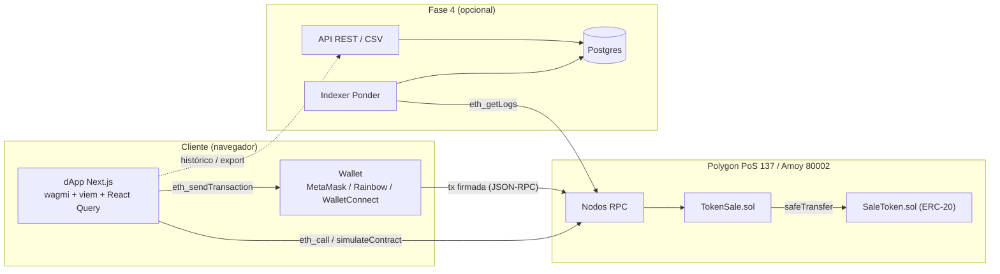
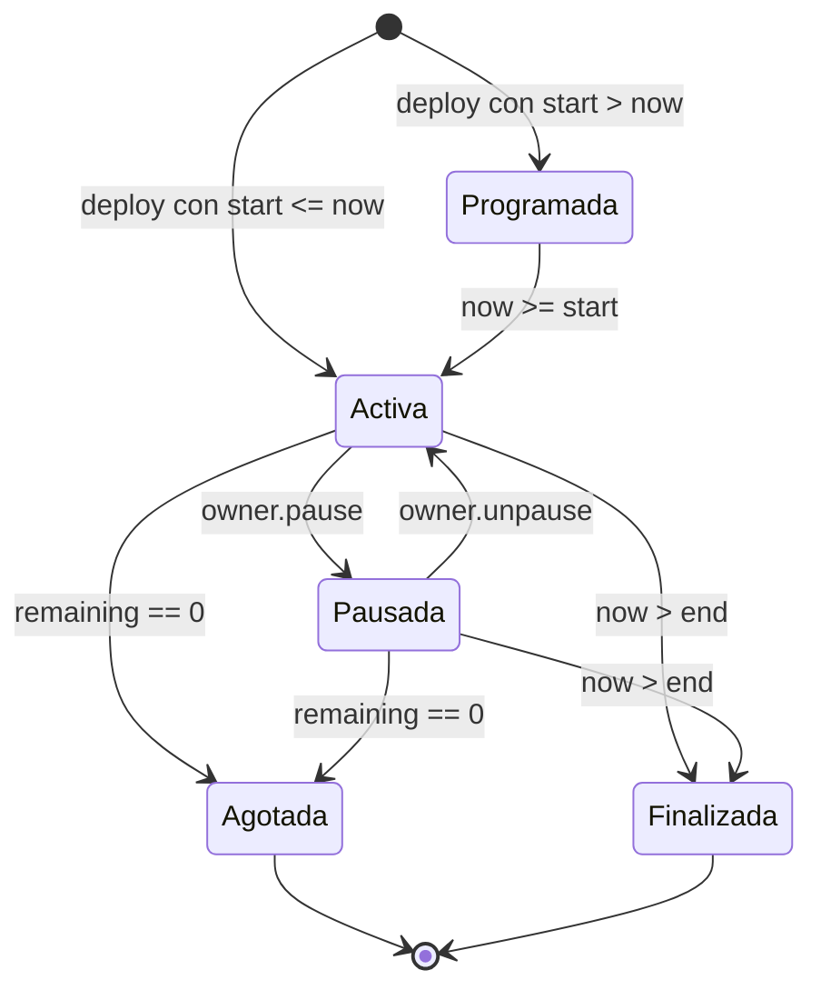

# DApp de venta de token sobre Polygon — Arquitectura

| | |
|---|---|
| **Versión** | 0.1 (propuesta para revisión) |
| **Fecha** | 2026-10-19 |
| **Estado** | Fase 0 — decisiones y diseño. **Todavía no hay código de producción.** |
| **Red objetivo** | Polygon PoS (`chainId 137`) · pruebas en Polygon Amoy (`chainId 80002`) |
| **Alcance** | Prototipo de venta primaria de un token ERC-20 a precio fijo en POL + panel público de estado y distribución |

---

## 0. Resumen

Un contrato `TokenSale` custodia el inventario del token, lo vende a precio fijo en **POL** (token nativo de Polygon, antes MATIC) y mantiene **toda la contabilidad on-chain**: tokens vendidos, restantes, POL recaudado, número de compradores y detalle por wallet.

Una dApp **Next.js + wagmi/viem** lee ese estado directamente del contrato por RPC y firma las compras con la wallet del usuario. **Sin backend propio, sin custodia de claves y sin confiar en el cliente para el precio**: el contrato es la única fuente de verdad.

```
Usuario ──firma──> Wallet ──tx──> TokenSale ──transfer──> Token ERC-20
   │                                  │
   └──lee estado──> dApp ──eth_call──> RPC Polygon
```

La decisión clave del diseño: **el contrato de venta es también el libro contable del dashboard**. Así la consulta de estado no depende de escanear eventos (frágil y caro en el navegador) y el prototipo puede funcionar sin infraestructura adicional. Un indexer de eventos se añade solo cuando haga falta histórico completo o “holders reales”.

---

## 1. Revisión crítica del alcance

El enunciado es correcto en la intención, pero tiene **seis puntos que hay que cerrar antes de escribir una línea de Solidity**. Si no se cierran, el prototipo se construye dos veces.

### 1.1 “Hash de wallet” no existe: es una dirección

- Una **dirección** es `0x` + 40 caracteres hex (`0x7A3…`), pública y estable. Es lo que se pide para consultar o para enviar tokens.
- Un **hash de transacción** (`0x` + 64 hex) identifica una operación, no una wallet.
- Una **clave privada / seed** es el secreto que firma. **La DApp no debe pedirla nunca, en ningún campo, ni siquiera “para verificar”.** Cualquier formulario que la pida es un phishing.

**Implicación:** el campo “pon tu wallet” es una **dirección pública** y solo sirve para *consultar* o para indicar el *destino* de los tokens. Para *pagar* hay que conectar la wallet y firmar; teclear una dirección no autoriza ningún cargo.

### 1.2 “Poner la wallet y el número de POL para comprar” mezcla dos modos

Hay que separar la UI en dos operaciones distintas:

| Modo | Entrada | Qué hace | Firma |
|---|---|---|---|
| **Consultar** | dirección `0x…` | lee `tokensPurchasedBy`, `weiPaidBy` | No |
| **Comprar** | wallet conectada + importe | `buy()` payable | Sí, la wallet conectada |

Si se permite teclear una dirección distinta de la conectada, el significado correcto es **“regalar tokens a esa dirección”** (`buyFor`): paga `msg.sender`, recibe el `receiver`. Es una función legítima, pero debe mostrarse claramente en el modal de confirmación para evitar regalos accidentales (o malware de portapapeles).

### 1.3 “Tokens distribuidos entre wallets” puede significar tres cosas

| Lectura | Dato necesario | Fuente |
|---|---|---|
| **A. Ventas de esta DApp** | compradores, importes, tokens | contabilidad del `TokenSale` (on-chain) |
| **B. Transferencias desde la wallet del propietario** (airdrops, equipo, tesorería) | historial `Transfer(from = owner)` | logs ERC-20 → **indexer** |
| **C. Holders actuales** (incluye compras secundarias) | saldos actuales de todas las wallets | logs `Transfer` + reconstrucción de saldos → **indexer** |

**ERC-20 no tiene enumeración de holders.** No se puede listar “todas las wallets con saldo” con una simple llamada. Para el prototipo propongo **A** (ventas de la DApp) y dejar **B/C** para la fase 4 con indexer. Hay que confirmar cuál es la necesidad real.

### 1.4 “Valor económico” necesita una unidad

El contrato liquida en **POL**. “Valorado en X €” es una capa de presentación:

- Opción simple: precio fijo en POL y el dashboard muestra POL + estimación EUR con un tipo de cambio.
- Opción pro: precio referenciado a EUR/USD con oráculo Chainlink (`POL/USD`) y actualización periódica. Añade dependencia externa y superficie de fallo.

Para el prototipo: **precio fijo en POL**, estimación EUR solo informativa (y etiquetada como tal).

### 1.5 “Wallet del contrato original” obliga a decidir dónde vive el inventario

Si los tokens están en la EOA del propietario, el contrato no puede venderlos salvo con `approve` + `transferFrom`, lo que añade pasos y confianza. Diseño propuesto: **el suministro se emite una sola vez al desplegar y el inventario se transfiere al `TokenSale`**. “Cuánto queda” = `token.balanceOf(sale)`, verificable por cualquiera.

### 1.6 Faltan en el alcance: reembolsos, límites, allowlist y legal

No están definidos y cambian el contrato: ¿devoluciones?, ¿mínimo/máximo por wallet?, ¿venta abierta o allowlist/KYC?, ¿vesting?, ¿qué pasa con lo no vendido?, ¿quién puede retirar la recaudación? Se proponen defaults en §14.

---

## 2. Decisiones de arquitectura

| ID | Decisión | Alternativa descartada | Motivo |
|---|---|---|---|
| **ADR-01** | Token **ERC-20 nuevo**, 18 decimales, suministro fijo, sin función `mint` | Token existente / ERC-721 | Control total y despliegue reproducible; el enunciado habla de tokens fraccionables |
| **ADR-02** | Contrato **`TokenSale` dedicado** que custodia el inventario | Vender desde la EOA con `transferFrom` | Precio y límites aplicados on-chain; estado consultable; sin firmas manuales por venta |
| **ADR-03** | Precio **fijo en POL** (wei) on-chain, mutable por el owner con tope y evento | Oráculo EUR/USD on-chain | Determinista y simple; el EUR es presentación |
| **ADR-04** | **Contabilidad on-chain + enumeración paginada** de compradores | Indexer desde el día 1 | Cero infraestructura; suficiente para el prototipo; migrable sin cambiar el contrato |
| **ADR-05** | **Sin backend propio** en fases 1–3 | API + base de datos | Menos superficie de ataque y coste; RPC + contrato bastan |
| **ADR-06** | Contratos **inmutables** (sin proxy) | UUPS / Transparent Proxy | Auditabilidad y simplicidad; si hace falta actualizar, se redespliega y se migra |
| **ADR-07** | **Foundry** (contratos) + **Next.js 15 / wagmi v2 / viem** (web) | Hardhat + ethers | Tests fuzz/invariant y ABI tipada; viem es ligero y tree-shakeable |
| **ADR-08** | Owner = **Safe multisig** en mainnet; EOA en Amoy | EOA también en mainnet | Reduce el riesgo de robo de clave y de “rug” accidental |
| **ADR-09** | **Amoy primero**, mainnet después | Solo mainnet | Probar con POL ficticio y repetir el flujo completo |
| **ADR-10** | **Sin upgradeabilidad y sin `delegatecall`** | Patrón proxy | Menos vectores; el contrato hace una sola cosa |

### Stack concreto

- **Contratos:** Solidity `^0.8.24`, OpenZeppelin Contracts 5.x (`ERC20`, `Ownable2Step`, `Pausable`, `ReentrancyGuard`, `SafeERC20`, `Math.mulDiv`), Foundry (`forge`, `cast`, `anvil`).
- **Web:** Next.js 15 (App Router) + TypeScript, Tailwind + shadcn/ui, `wagmi` v2, `viem`, `@tanstack/react-query`, RainbowKit (o ConnectKit) para la conexión.
- **Indexer (fase 4, opcional):** Ponder (viem + Postgres) o subgraph de The Graph.
- **Hosting:** Vercel (web) + RPC de Alchemy/Infura/QuickNode con fallback público.
- **Explorador:** Polygonscan (mainnet) y Amoy Polygonscan.

---

## 3. Vista de componentes



### Responsabilidades

| Componente | Responsabilidad | No debe hacer |
|---|---|---|
| `SaleToken` | ERC-20 estándar, suministro fijo | Mintear después del despliegue, tasas, rebasing |
| `TokenSale` | Custodiar inventario, cobrar, contabilizar, aplicar límites, retirar recaudación | Custodiar claves, depender de un oráculo, tener lógica de negocio ajena a la venta |
| dApp | Leer estado, validar en cliente, construir y simular la tx, mostrar resultado | Firmar, guardar claves, decidir el precio |
| Wallet | Autorizar y firmar | Nada más |
| Indexer (f4) | Histórico completo y consultas agregadas | Ser la fuente de verdad para el estado actual |

---

## 4. Modelo on-chain

### 4.1 `SaleToken.sol`

ERC-20 estándar con:

- `name`, `symbol`, `decimals = 18`.
- `constructor(uint256 initialSupply, address treasury)` → `_mint(treasury, initialSupply)`.
- **Sin `mint` posterior** (suministro inmutable), sin `burn`, sin fees, sin `permit` (no hace falta).
- Hereda de OpenZeppelin `ERC20`; no se toca la lógica de transferencias.

> El despliegue emite el 100 % del suministro al deployer; el script transfiere el inventario al `TokenSale` en la misma transacción de despliegue (§8). Lo que no se venda se queda en el `TokenSale` hasta el barrido posterior al cierre.

### 4.2 Estado del `TokenSale`

```solidity
// Identidad e inventario
IERC20  public immutable token;
uint8   public immutable tokenDecimals;   // 18, cacheado
uint256 public immutable totalSupply;     // leído en el constructor

// Economía
uint256 public pricePerTokenWei;          // wei de POL por 1 token entero (1e18 unidades)
uint256 public maxPricePerTokenWei;       // tope defensivo de setPrice
uint256 public minTokensPerPurchase;
uint256 public maxTokensPerWallet;        // 0 = sin límite
uint64  public startTime;
uint64  public endTime;

// Contabilidad
uint256 public totalTokensSold;
uint256 public totalRaisedWei;
uint256 public buyerCount;

mapping(address => uint256) public tokensPurchasedBy;
mapping(address => uint256) public weiPaidBy;
mapping(address => bool)    private _isBuyer;
address[] private _buyers;
```

**Por qué `weiPaidBy`:** si el precio cambia, el POL pagado por cada wallet **no** se puede derivar de los tokens comprados. Guardarlo por separado mantiene el dashboard exacto y permite conciliar `sum(weiPaidBy) == totalRaisedWei`.

### 4.3 Interfaz pública (ABI de referencia)

```solidity
interface ITokenSale {
    struct SaleState {
        address token;
        uint8   tokenDecimals;
        uint256 pricePerTokenWei;
        uint256 totalSupply;
        uint256 remainingTokens;   // balance del contrato de venta
        uint256 totalTokensSold;
        uint256 totalRaisedWei;
        uint256 buyerCount;
        uint64  startTime;
        uint64  endTime;
        bool    paused;
    }

    event TokensPurchased(
        address indexed buyer,
        address indexed receiver,
        uint256 tokenAmount,
        uint256 paidWei
    );
    event PriceUpdated(uint256 oldPriceWei, uint256 newPriceWei);
    event SaleWindowUpdated(uint64 startTime, uint64 endTime);
    event ProceedsWithdrawn(address indexed to, uint256 amountWei);
    event UnsoldSwept(address indexed to, uint256 tokenAmount);

    // --- Usuario ---
    function buy(uint256 tokenAmount) external payable;
    function buyFor(address receiver, uint256 tokenAmount) external payable;

    // --- Lectura ---
    function quote(uint256 tokenAmount) external view returns (uint256 costWei);
    function saleState() external view returns (SaleState memory);
    function remainingTokens() external view returns (uint256);
    function tokensPurchasedBy(address buyer) external view returns (uint256);
    function weiPaidBy(address buyer) external view returns (uint256);
    function getBuyers(uint256 offset, uint256 limit)
        external view
        returns (address[] memory buyers, uint256[] memory tokenAmounts, uint256[] memory paidWei);

    // --- Owner ---
    function setPrice(uint256 newPriceWei) external;
    function setSaleWindow(uint64 startTime, uint64 endTime) external;
    function pause() external;
    function unpause() external;
    function withdrawProceeds(address payable to) external;
    function sweepUnsold(address to) external;
    function sweepForeignToken(IERC20 otherToken, address to) external;
}
```

### 4.4 Reglas de `buy` (orden exacto de validación)

1. `whenNotPaused`.
2. `block.timestamp >= startTime` y `block.timestamp <= endTime`.
3. `tokenAmount > 0` y `tokenAmount >= minTokensPerPurchase`.
4. `tokenAmount <= remainingTokens()` (si no: `SoldOut`).
5. `receiver != address(0)` y `receiver != address(this)` (si no: `InvalidReceiver`).
6. `tokensPurchasedBy[receiver] + tokenAmount <= maxTokensPerWallet` (si el límite es > 0).
7. `cost = quote(tokenAmount)` y `msg.value == cost` (sin reembolsos parciales; el exceso revierte).
8. **Checks-Effects-Interactions:** actualizar `tokensPurchasedBy`, `weiPaidBy`, `totalTokensSold`, `totalRaisedWei`, `buyerCount`, `_buyers`.
9. `token.safeTransfer(receiver, tokenAmount)`.
10. `emit TokensPurchased(msg.sender, receiver, tokenAmount, cost)`.

`quote(amount) = Math.mulDiv(amount, pricePerTokenWei, 10 ** tokenDecimals)`.

> Redondeo: `mulDiv` trunca a favor del comprador por menos de 1 wei. Aceptable y documentado; los tests lo cubren.

### 4.5 Errores personalizados

```solidity
error SalePaused();
error SaleNotStarted();
error SaleEnded();
error ZeroAmount();
error BelowMinimum(uint256 minimum);
error SoldOut();
error AboveWalletCap(uint256 cap);
error IncorrectPayment(uint256 expectedWei, uint256 receivedWei);
error InvalidReceiver();
error InvalidPrice();
error InvalidWindow();
error SaleNotEnded();
error InvalidToken();
error TransferFailed();
```

Los mensajes de la UI se mapean desde estos selectores, no desde textos de RPC.

### 4.6 Invariantes (verificables con tests)

1. `token.balanceOf(sale) + totalTokensSold == totalSupply` (sin transferencias externas al contrato).
2. `sum(weiPaidBy[buyer]) == totalRaisedWei`.
3. `sum(tokensPurchasedBy[buyer]) == totalTokensSold`.
4. `buyerCount == _buyers.length` y cada dirección aparece una sola vez.
5. Ninguna compra fuera de `[startTime, endTime]`, en pausa, por encima del cap o con `msg.value` distinto de `quote`.
6. `totalTokensSold <= totalSupply` **siempre**.

### 4.7 Estados de la venta



El estado se deriva en lectura (no se almacena) para evitar escrituras y condiciones de carrera:

```
paused                        -> PAUSADA
now < start                   -> PROGRAMADA
remaining == 0                -> AGOTADA
now > end                     -> FINALIZADA
resto                         -> ACTIVA
```

### 4.8 Funciones de owner y superficies de confianza

| Función | Quién | Guardas | Efecto |
|---|---|---|---|
| `setPrice` | owner | `0 < newPrice <= maxPrice`, evento | Cambia el precio de las compras futuras |
| `setSaleWindow` | owner | `start < end`, evento | Ajusta la ventana |
| `pause` / `unpause` | owner | `Pausable` | Bloquea compras (no retiradas) |
| `withdrawProceeds(to)` | owner | `to != 0`, `nonReentrant`, evento | Envía todo el POL del contrato |
| `sweepUnsold(to)` | owner | `now > endTime`, `to != 0`, evento | Envía los tokens no vendidos |
| `sweepForeignToken` | owner | `otherToken != token` | Recupera ERC-20 enviados por error |

> **Riesgo inherente:** el owner puede retirar la recaudación y cambiar el precio. No es un bug, es un modelo de confianza. Se mitiga con Safe multisig, eventos y, si el cliente lo exige, con un `beneficiary` inmutable y precio congelado (variante del contrato, no del prototipo).

---

## 5. Estrategia de datos y consultas

### 5.1 Fase 1–3: lectura directa por RPC

| Dato | Llamada | Coste |
|---|---|---|
| Snapshot del dashboard | `saleState()` | 1 `eth_call` |
| Página de compradores | `getBuyers(offset, 50)` | 1 `eth_call` |
| Detalle de una wallet | `tokensPurchasedBy(addr)` + `weiPaidBy(addr)` | 1–2 `eth_call` (o `multicall`) |
| Balances y metadatos | `balanceOf`, `symbol`, `decimals` | 1 `multicall` |

`getBuyers` limita `limit <= 100` para evitar respuestas gigantes y abuso de gas de lectura. La UI pagina de 25 en 25.

**No se usa `eth_getLogs` desde el navegador:** los RPC públicos limitan el rango de bloques y el resultado es frágil. Si se necesita histórico, se hace en un indexer.

### 5.2 Cuándo añadir un indexer

Señales para pasar a Ponder/The Graph:

- Más de ~2.000 compradores (la paginación on-chain se vuelve incómoda).
- Necesidad de histórico por fecha, gráficas, export CSV o “holders reales” (lecturas B/C de §1.3).
- Varias fuentes de datos (varios contratos o cadenas).
- Necesidad de consultas por rango temporal.

El indexer **no sustituye** la lectura on-chain para el estado actual: `saleState()` sigue mandando. El indexer añade histórico y agregados.

### 5.3 Modelo del indexer (fase 4)

```
Tabla sales:  id, tx_hash, block_number, block_time, buyer, receiver,
              token_amount, paid_wei, price_wei
Tabla buyers: address, tokens_total, paid_total, first_seen, last_seen
```

Endpoints previstos:

```
GET /api/sale                 -> SaleState + métricas derivadas
GET /api/buyers?limit&offset  -> lista paginada
GET /api/buyers/:address      -> detalle
GET /api/export.csv           -> export para conciliación
```

### 5.4 Caché en la dApp

- TanStack Query con `staleTime: 10_000` y `refetchInterval: 15_000` (Polygon produce bloques ~2 s; no hace falta más).
- Invalidar `['sale']`, `['buyers']` y `['buyer', addr]` al recibir el recibo de una compra.
- No cachear en `localStorage` datos que puedan quedar obsoletos sin marca de tiempo.

---

## 6. Frontend

### 6.1 Rutas

| Ruta | Contenido |
|---|---|
| `/` | Dashboard + formulario de compra |
| `/wallet/[address]` (o `?addr=`) | Consulta read-only de una wallet |
| `/admin` (fase 4) | Pausa, precio, retirada, barrido; visible solo si `owner() == cuenta` |
| `/legal` | Términos, privacidad y aviso de riesgo |

### 6.2 Dashboard: métricas

- Nombre, símbolo, suministro total y dirección del token (con enlace a Polygonscan).
- Precio actual en POL (y estimación EUR opcional, etiquetada).
- Tokens vendidos / restantes / **% vendido** (barra de progreso).
- POL recaudado (y estimación EUR).
- Nº de compradores.
- **FDV** = precio × suministro; **valor vendido** = precio × vendidos (ambos con la salvedad de que el precio puede haber cambiado).
- Estado de la ventana (programada / activa / pausada / agotada / finalizada) y cuenta atrás.
- Dirección del contrato de venta y del token, verificadas y enlazadas al explorador.
- Tabla de últimas compras (paginada) y buscador por wallet.

### 6.3 Flujo de compra (UI)

1. **Conectar wallet** (RainbowKit). Si la red no es Polygon/Amoy, mostrar botón “Cambiar a Polygon” (`wallet_switchEthereumChain`).
2. **Leer estado** con `saleState()`. Si no está activa, deshabilitar el formulario con el motivo.
3. **Introducir cantidad** (en POL o en tokens, con toggle) y, opcionalmente, **dirección destino** distinta de la conectada (`buyFor`).
4. **Calcular** `quote()` en vivo; mostrar precio unitario, total y comisión de gas estimada.
5. **Validar**: dirección con checksum (`getAddress`/`isAddress`), saldo suficiente para importe + gas, límites de la ventana.
6. **Simular** con `simulateContract` antes de firmar. Si revierte, mostrar el error mapeado y no abrir la wallet.
7. **Confirmar** en un modal con: red, contrato, destino, cantidad, total, gas estimado y aviso si `destino != wallet conectada`.
8. **Firmar y enviar**; mostrar el hash inmediatamente con enlace al explorador.
9. **Esperar recibo** (`waitForTransactionReceipt`, timeout ~90 s). Si `status === 'reverted'`, informar y refrescar.
10. **Refrescar** estado y tabla; mostrar resumen (“has recibido X TK por Y POL”).

### 6.4 Consulta por wallet

- Acepta `0x…` (40 hex). Valida checksum y muestra la dirección completa en formato corto + copiar.
- Devuelve: tokens comprados, POL pagados, % del total vendido, fecha de la primera compra (si hay indexer) y enlace a la tx.
- Si la dirección no ha comprado: estado vacío explícito, no un error.
- **Nunca** se envía la dirección a analítica de terceros sin consentimiento (dato personal según GDPR).

### 6.5 Configuración

```env
NEXT_PUBLIC_CHAIN_ID=80002
NEXT_PUBLIC_SALE_ADDRESS=0x...
NEXT_PUBLIC_TOKEN_ADDRESS=0x...
NEXT_PUBLIC_RPC_URL=https://...
NEXT_PUBLIC_WC_PROJECT_ID=...
```

- Direcciones y ABI en `web/lib/deployments.ts`, generadas desde `deployments/<chainId>.json`; **nunca** se aceptan direcciones por query string para operar.
- La clave del RPC, si es de proveedor, se restringe por dominio en el panel del proveedor; nunca se asume secreta.

### 6.6 Manejo de errores

| Condición | Mensaje UX |
|---|---|
| Usuario rechaza la firma | “Has cancelado la firma” (sin reintentar automáticamente) |
| Red incorrecta | “Estás en otra red” + botón de cambio |
| Saldo insuficiente | “No tienes POL suficiente para el importe + gas” |
| `SoldOut` | “No quedan tokens disponibles” |
| `AboveWalletCap` | “Superas el máximo por wallet (X TK)” |
| `IncorrectPayment` | “El precio ha cambiado; recalculando…” + re-quote |
| `SaleNotStarted` / `SaleEnded` | “La venta no está activa” |
| `SalePaused` | “La venta está pausada temporalmente” |
| Error de RPC / timeout | “No se pudo contactar con la red; reintenta” + reintento manual |

Los errores se decodifican con el ABI (`decodeErrorResult`) para no mostrar mensajes crudos del nodo.

---

## 7. Seguridad

### 7.1 Modelo de amenazas

| # | Amenaza | Vector | Mitigación | Residual |
|---|---|---|---|---|
| 1 | Robo de clave/seed | Phishing, malware, web falsa | Nunca pedir seed; hardware wallet; educación; dominio oficial | Usuario comprometido |
| 2 | Sustitución de contrato/ABI | DNS o JS comprometido | Direcciones fijas en config versionada; verificación en Polygonscan; CSP y dependencias fijadas | Hosting/CDN |
| 3 | Cambio de dirección (portapapeles) | Malware | Mostrar dirección completa con checksum en el modal; comparar con la pegada | Malware local |
| 4 | Reentrancy | `to.call` en retiradas o token malicioso | CEI + `nonReentrant` + token propio | Bajo |
| 5 | Precio manipulado en cliente | Usuario edita JS | El contrato valida `msg.value == quote` | Nulo |
| 6 | Front-running del cambio de precio | Owner sube precio | Evento + tope + transparencia; timelock opcional | Medio |
| 7 | “Rug” del owner | Retirada o cambio de precio | Safe multisig + eventos + documentación; variante con `beneficiary` inmutable | Medio |
| 8 | DoS por enumeración | Muchos compradores | Paginación + límite de `limit`; indexer en fase 4 | Bajo |
| 9 | RPC deshonesto/obsoleto | Proveedor o red | Varios RPC en fallback; confirmar con recibo; leer logs del recibo | Bajo |
| 10 | Clon de la dApp | Dominio parecido | Dominio oficial, verificación, comunicación | Externo |
| 11 | POL/tokens enviados por error | Usuario | Sin `receive()` genérico; `sweepForeignToken`; documentación | Tokens bloqueados hasta barrido |
| 12 | Precisión/redondeo | Aritmética | `mulDiv`, 18 decimales, tests de borde | Nulo |
| 13 | Congelación por pausa | Owner | Pausa solo bloquea compras, no retiradas ni barrido | Confianza |

### 7.2 Controles en el contrato (checklist)

- [ ] OpenZeppelin 5.x: `Ownable2Step`, `Pausable`, `ReentrancyGuard`, `SafeERC20`, `Math.mulDiv`.
- [ ] CEI en `buy` / `buyFor`; `nonReentrant` en `buy`, `buyFor`, `withdrawProceeds`.
- [ ] `msg.value` exacto (sin reembolsos parciales) y validación de todos los límites.
- [ ] `buyerCount` y `_buyers` sin duplicados (`_isBuyer`).
- [ ] `withdrawProceeds` y `sweepUnsold` solo owner, con evento y destino no nulo.
- [ ] `sweepUnsold` solo después de `endTime`.
- [ ] Sin `receive()`/`fallback()` genéricos; solo `buy` es payable.
- [ ] Sin `delegatecall`, sin `selfdestruct`, sin `tx.origin`.
- [ ] Token sin fees de transferencia, sin rebasing y sin `mint` posterior.
- [ ] `maxPricePerTokenWei` como cota dura de `setPrice`.
- [ ] Tests unitarios + fuzz + invariantes + fork de Amoy.
- [ ] Verificación en Polygonscan + Sourcify; ownership a Safe antes de mainnet.

### 7.3 Controles en la dApp (checklist)

- [ ] No se pide seed ni clave privada en ningún flujo, ni siquiera “para verificar”.
- [ ] `simulateContract` antes de cada escritura.
- [ ] Modal de confirmación con red + contrato + destino + importe.
- [ ] Validación de checksum y bloqueo de direcciones inválidas o `0x0`.
- [ ] `bigint` en todo el camino; nunca `number` para wei.
- [ ] Manejo de `status: 'reverted'` del recibo, no solo del envío.
- [ ] Bloqueo de doble envío y de envíos con la ventana cerrada.
- [ ] CSP, `SRI` si hay scripts externos, dependencias con lockfile.
- [ ] Sin analítica con direcciones ni datos personales sin consentimiento.
- [ ] Enlaces al explorador correctos por red (Amoy vs mainnet).

### 7.4 Antes de mainnet

1. Congelar ABI y direcciones; etiquetar el release.
2. Repetir el flujo completo en Amoy con varias wallets y casos límite.
3. Revisión externa (auditoría o, como mínimo, peer review con checklist).
4. Ownership a Safe multisig; claves en hardware wallet.
5. Verificar contratos y publicar direcciones en un canal oficial.
6. Monitorizar: alertas de balance, de pausa y de eventos `TokensPurchased`.
7. Plan de incidentes: pausar, comunicar, y decidir sobre reembolsos por escrito.

---

## 8. Entornos y despliegue

| Entorno | Red | chainId | Uso |
|---|---|---|---|
| Local | Anvil | 31337 | Tests y desarrollo |
| Testnet | Polygon Amoy | 80002 | E2E con POL ficticio |
| Producción | Polygon PoS | 137 | Venta real |

### 8.1 Secuencia de despliegue (un solo script)

1. `SaleToken(initialSupply, deployer)` → suministro fijo emitido al deployer.
2. `TokenSale(token, price, start, end, minTokens, maxPerWallet, owner)`.
3. `token.transfer(sale, inventory)` → el contrato de venta recibe el inventario.
4. Verificar ambos contratos en Polygonscan.
5. Escribir `deployments/80002.json` con direcciones, bloque y hashes.
6. (Mainnet) Transferir la ownership a la Safe **y verificar** que el owner es la Safe.

```bash
forge script script/Deploy.s.sol \
  --rpc-url "$POLYGON_AMOY_RPC_URL" \
  --broadcast --verify --etherscan-api-key "$POLYGONSCAN_API_KEY"
```

> Claves: `--keystore`/hardware wallet o variable de entorno en el CI. Nunca en el repo. `.env.example` solo con nombres.

### 8.2 Configuración de la web por entorno

- Preview/staging apunta a Amoy; producción a 137.
- `NEXT_PUBLIC_*` se inyecta en build; un cambio de dirección exige rebuild (y eso es bueno: queda versionado).
- Fallback de RPC configurado en `wagmi` (`fallback([...])`) con dos proveedores.

---

## 9. Estructura de repositorio propuesta

```
dapp-tk-basic/
├── contracts/                    # Foundry
│   ├── src/
│   │   ├── SaleToken.sol
│   │   └── TokenSale.sol
│   ├── test/
│   │   ├── TokenSale.t.sol
│   │   ├── TokenSale.fuzz.t.sol
│   │   └── TokenSale.invariants.t.sol
│   ├── script/Deploy.s.sol
│   ├── foundry.toml
│   └── .env.example
├── web/                          # Next.js
│   ├── app/
│   │   ├── page.tsx              # dashboard + compra
│   │   ├── wallet/[address]/page.tsx
│   │   └── admin/page.tsx        # fase 4
│   ├── components/
│   ├── lib/
│   │   ├── chains.ts
│   │   ├── contracts.ts          # ABI + direcciones
│   │   └── format.ts
│   └── .env.example
├── deployments/
│   ├── 80002.json
│   └── 137.json
├── docs/
│   └── ARQUITECTURA.md
└── README.md
```

- La ABI se genera con `forge inspect TokenSale abi` (o `wagmi generate`) y se versiona.
- `deployments/*.json` es la única fuente de direcciones; la web la importa en build.

---

## 10. Plan por fases y criterios de aceptación

| Fase | Alcance | Estimación | Criterio de aceptación |
|---|---|---|---|
| **0. Arquitectura** | Este documento + decisiones cerradas | 0,5–1 día | Revisión aprobada; §14 resuelto |
| **1. Contratos** | `SaleToken`, `TokenSale`, tests, deploy Amoy | 2–3 días | `forge test` verde (unit + fuzz + invariantes); contratos verificados en Amoy; script reproducible |
| **2. Dashboard** | Lectura de estado, métricas, consulta por wallet | 2 días | Datos coinciden con el contrato; < 3 s de carga; responsive; sin errores de consola |
| **3. Compra E2E** | Formulario, simulación, firma, recibo, errores | 2–3 días | Compras de importe mínimo, normal y por encima del cap; red incorrecta; firma rechazada; agotado; totales conciliados a mano |
| **4. Extras** | Indexer, admin, EUR, CSV, preparación de auditoría | 2–4 días | Indexer cuadra con on-chain; export CSV válido; revisión de seguridad hecha |

**Total prototipo en Amoy: ~7–12 días de desarrollo.**

### Fuera de alcance (explícito)

Pago con tarjeta/fiat, KYC/AML, preventa con allowlist, vesting, reembolsos, mercado secundario, staking, dividendos, app móvil nativa, multi‑chain, upgradeabilidad, auditoría formal (se recomienda antes de mainnet, pero no es parte del prototipo).

---

## 11. Riesgos y aspectos legales

### 11.1 Riesgos técnicos

| Riesgo | Impacto | Mitigación |
|---|---|---|
| Bug en el contrato | Pérdida de fondos | Tests + revisión + inmutabilidad + límites |
| Clave del owner comprometida | Retirada no autorizada | Safe multisig + hardware wallet + alertas |
| RPC caído o lento | dApp inoperativa | Fallback de proveedores + reintentos |
| Precio fijo vs volatilidad de POL | El “valor” en EUR se mueve | Mostrar estimación y avisar; o precio referenciado con oráculo en una fase posterior |
| Enumeración on-chain costosa | Dashboard lento con miles de compradores | Paginación + indexer |
| Web comprometida | Phishing | CSP, dependencias fijadas, dominio, verificación |

### 11.2 Legal (no es asesoría jurídica)

- **MiCA (UE):** la emisión y venta de un criptoactivo puede requerir documento informativo (white paper) y obligaciones según el tipo de token. Si el token da derechos económicos o de participación, puede caer además en MiFID II (valor negociable).
- **KYC/AML:** si se aceptan pagos fiat o se vende al público en volumen, puede ser exigible identificar a los compradores.
- **GDPR:** una dirección de wallet puede considerarse dato personal; minimizar, no enviar a analítica de terceros sin base legal, definir retención.
- **Fiscalidad:** IVA/IRPF/impuesto de sociedades según jurisdicción y naturaleza de la venta.
- **Recomendación:** revisión legal antes de mainnet, no antes del prototipo en Amoy.

---

## 12. Glosario rápido

| Término | Significado |
|---|---|
| **POL** | Token nativo de Polygon PoS (sustituyó a MATIC en 2024, 1:1). Paga gas y la compra. |
| **wei** | Unidad mínima de POL: `1 POL = 10^18 wei`. |
| **ERC-20** | Estándar de token fungible; no permite enumerar holders por sí solo. |
| **RPC** | Punto de acceso JSON-RPC a la blockchain. |
| **Indexer** | Proceso que lee eventos y construye una base de datos consultable. |
| **FDV** | Fully Diluted Valuation: precio × suministro total. |
| **Checksum** | Codificación de mayúsculas/minúsculas que detecta direcciones mal escritas. |
| **CEI** | Checks-Effects-Interactions, patrón anti-reentrancy. |
| **Safe** | Multisig estándar en Ethereum/Polygon. |

---

## 13. Qué se decide con este documento

1. El contrato de venta es la **fuente de verdad** del estado y la contabilidad.
2. El **inventario vive en el contrato**, no en la wallet del propietario.
3. La compra **siempre la firma la wallet conectada**; teclear una dirección solo consulta o designa destino.
4. **Sin backend** hasta que el volumen o el histórico lo justifiquen.
5. **Amoy primero**, mainnet solo tras checklist y revisión.

---

## 14. Decisiones abiertas (responder o aceptar los defaults)

| # | Pregunta | Default propuesto |
|---|---|---|
| D1 | ¿Token nuevo o existente? | **Nuevo ERC-20**, 18 decimales, 1.000.000 TK de ejemplo |
| D2 | ¿Precio y moneda de liquidación? | **0,01 POL/TK** (ejemplo), configurable con tope |
| D3 | ¿Qué significa “distribución”? | **A: ventas de esta DApp**; B/C con indexer en fase 4 |
| D4 | ¿Límites de compra? | Mínimo 10 POL, máximo 1.000 POL por wallet |
| D5 | ¿Ventana de venta? | Inicio inmediato, cierre a 30 días |
| D6 | ¿Red? | **Amoy** para el prototipo; mainnet después |
| D7 | ¿Quién es el owner? | EOA en Amoy; **Safe** en mainnet |
| D8 | ¿Indexer desde el inicio? | **No**, fase 4 |
| D9 | ¿Mostrar EUR? | Solo estimación informativa, sin oráculo |
| D10 | ¿Reembolsos / vesting / allowlist? | **Ninguno** en el prototipo |

Con los defaults aceptados se puede pasar a la Fase 1 (contratos y tests) sin más preguntas.
